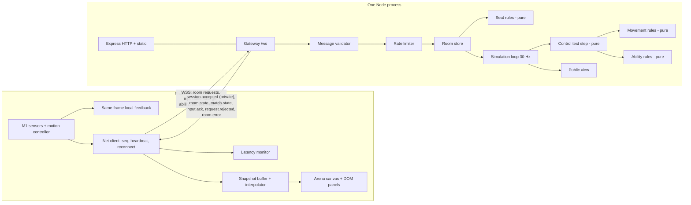
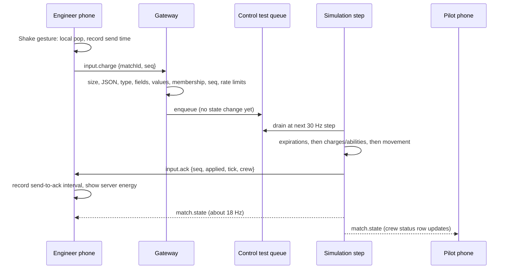
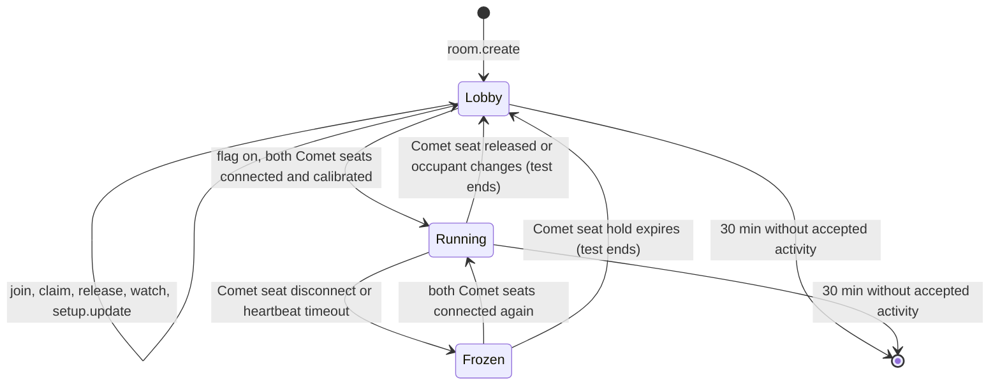

# Design Document: M2 Shared Control

## Overview

M2 proves that two phones can control one rocket through an authoritative server. It adds:

- An in-memory room flow: create/join, a six-character room code, share link and QR, four fixed seats, a host, private reconnect tokens, and inactivity expiry.
- A `ws` WebSocket gateway on the existing Express HTTP server, same origin, path `/ws`, with origin checks, validation before mutation, rate limits, heartbeats, and applied-state acknowledgements.
- A development-only **control test**: one Comet rocket, steered by the Comet Pilot and powered by the Comet Engineer. The server owns movement, energy, the selected ability, effects, and the shared cooldown. It runs at a fixed 30 Hz and broadcasts at about 18 Hz. Clients interpolate.
- A read-only Watch view, and client-side latency diagnostics (p95 send-to-applied-ack, measured separately from render delay).

M2 reuses the M1 code: the pure motion modules, setup screen, arena canvas, design tokens, `abilities.ts`, and the Express server. The M1 sensor test stays reachable from Home.

Out of scope: second rocket, course walls, checkpoints, cores, scoring, timer, results, Ready, match start, pause/resume countdown, rematch, role swaps (M3/M4).

### Key decisions

| ID | Decision | Rationale |
| --- | --- | --- |
| M2-1 | The control test starts automatically when both Comet seats are connected and calibrated. There is no start button, countdown, timer, score, or result. | A start button for two players would look like a two-player mode. Automatic start keeps the proof internal and needs no host action. |
| M2-2 | The control test is behind a server flag. It is on in development mode (`--dev`) and in production only when `RR_CONTROL_TEST=1`. | The deployed site must not offer a public two-player game. The user turns it on manually for the device test and off afterward. |
| M2-3 | All four seats are claimable, but only the Comet crew flies. Nova seats see the read-only arena and a note. | Requirement 2.1 needs four fixed seats and unique claims. A second rocket is M3. Comet matches the M1 sensor test. |
| M2-4 | M2 keeps the rocket inside the 600 × 800 arena (inset by the 18-unit radius) with a simple clamp. No wall slowdown. | The course and wall rules are M3 task 3.1. A clamp keeps the rocket visible and finite without inventing wall physics. |
| M2-5 | Inputs are validated on arrival, queued, and applied in the next fixed step. The ack is sent after that step and carries the tick and resulting state. | PRD 2 measures send to an ack of **applied** state, not socket receipt. Up to one step (33 ms) is part of the honest measurement. |
| M2-6 | Session time freezes while a Comet seat is disconnected. Steering resets to 0 at once. Reconnecting resumes the same control test without a countdown. | Matches the PRD 8 rule (no stale steering, frozen timers) without building the M4 pause/resume flow. |
| M2-7 | Origins: allowlist from `RENDER_EXTERNAL_URL` and `ALLOWED_ORIGINS`. In `--dev` mode, an origin whose host equals the request `Host` header is also allowed (Vite proxy on the LAN). | Render sets `RENDER_EXTERNAL_URL` to the service's onrender.com URL ([Render default env vars](https://render.com/docs/environment-variables)). LAN IPs change, so dev uses a same-host check, which still blocks cross-site pages. |
| M2-8 | CSP `connect-src` lists `'self'` plus the explicit `wss://` form of each allowed origin. | MDN notes that `connect-src 'self'` does not resolve to WebSocket schemes in every browser, and Safari has refused same-host `wss:` under `'self'` ([MDN connect-src](https://developer.mozilla.org/en-US/docs/Web/HTTP/Reference/Headers/Content-Security-Policy/connect-src)). The M1 comment in `server/app.ts` that `'self'` covers WSS is corrected. |
| M2-9 | Per-IP limits use the socket address, or the entry `RR_TRUSTED_PROXY_HOPS` from the right of `X-Forwarded-For` when that variable is set. `render.yaml` sets it to `1`. | Behind Render's proxy every socket address is the proxy. Only the proxy-appended entry is trustworthy; leftmost entries are client-controlled ([Express behind proxies](https://expressjs.com/en/guide/behind-proxies.html)). The hop count must be checked on the deployed site. |
| M2-10 | The server is compiled with `tsc` from `server/` and `src/shared/` into `dist-server/`. Shared modules use `.js` relative import specifiers. | The server must import the shared rules. Node ESM needs explicit extensions; Vite and the `bundler` resolution accept them. No bundler is added for the server. |
| M2-11 | The engineer client keeps local selection logic for same-frame feedback and reconciles to the server's selected ability. The M1 local energy/cooldown simulation is used only by the M1 sensor test. | PRD 8 and D5: the server owns the choice; the phone shows it at once. |
| M2-12 | Room creation, join, seat, and setup messages carry a `requestId`; gameplay inputs carry `matchId` and `seq`. | Matches the implementation plan's contract (Section 3.6), so M3 extends rather than replaces it. |

### User decision: paid Render instance

The implementation plan moves the demo link to a paid Render web service in M2, because free instances spin down after 15 minutes idle and lose in-memory rooms ([Render free limits](https://render.com/docs/free)). Render lists the `0.5c-512mb` (formerly Starter) size at $7/month for compute; verify at provisioning. This spec does **not** change `plan: free` in `render.yaml` and creates no task that incurs cost. The user decides whether and when to switch. Until then, a deployed room can vanish when the instance sleeps, which the client reports as a lost connection. The README records this as a manual step.

## Architecture



### Input to acknowledgement



### Room and control test lifecycle



The room phase stays `lobby` in M2. The control test is a nested, optional record. M3 adds the `countdown`, `running`, and `results` room phases.

### File layout

Existing paths are kept. The server lives in `server/` (not `src/server/` as in the implementation plan tree).

```text
server/
  main.ts              [change] attach Gateway, start loops, graceful room.error on shutdown
  app.ts               [change] CSP connect-src from allowed origins
  config.ts            [change] server-only values: WS path, frame cap, loop and sweep intervals, env parsing
  origin.ts            [new] pure origin allowlist and same-host check
  client-ip.ts         [new] pure source IP from socket address and X-Forwarded-For
  rate-limit.ts        [new] pure sliding-window limiter
  validate.ts          [new] pure Message_Validator
  rooms.ts             [new] Room_Store: rooms, participants, seats, tokens, holds, expiry
  public-view.ts       [new] allowlist serializers for room.state and match.state
  simulation.ts        [new] fixed-step loop, input queues, acks, broadcasts
  dispatch.ts          [new] socket-free message handling: checks, store calls, outbound messages
  websocket.ts         [new] Gateway: upgrade, binding, heartbeat, wiring to dispatch
src/shared/
  config.ts            [change] M2 constants; PREVIEW_* derived from shared values
  protocol.ts          [new] message and public state types, reason codes, seat ids
  rules/abilities.ts   [change] selected ability, select and activate-selected
  rules/seats.ts       [new] pure seat and host rules
  rules/physics.ts     [new] pure rocket movement and arena clamp
  rules/control-test.ts [new] pure step: inputs + time -> next state + results
src/client/
  app.ts               [change] new screens, net client in context
  net/socket.ts        [new] WSS lifecycle, heartbeat, reconnect, seq, pending sends
  net/session.ts       [new] sessionStorage token per room; share link build and parse
  room-context.ts      [new] latest room.state/match.state, own seat, navigation for room screens
  crew-view.ts         [new] pure reducer: local predictions reconciled to server crew state
  net/interpolate.ts   [new] pure snapshot buffer and pose interpolation
  net/latency.ts       [new] pure latency statistics
  motion/controller.ts [change] server-authority mode
  ui/home-screen.ts    [new] Create room, Join room, Sensor test link
  ui/join-screen.ts    [new] code and name form (create and join modes)
  ui/lobby-screen.ts   [new] code, QR, share, four seat cards, Watch link
  ui/qr.ts             [new] QR as DOM SVG nodes
  ui/control-screen.ts [new] Pilot/Engineer control over the network
  ui/pilot-panel.ts    [new] extracted from pilot-screen.ts
  ui/engineer-panel.ts [new] extracted from engineer-screen.ts
  ui/crew-status.ts    [new] pilot's read-only crew status row
  ui/room-watch-screen.ts [new] read-only arena for watchers and Nova seats
  ui/error-screen.ts   [new] full-screen error card
  ui/copy.ts           [new] reject reason and room error copy
  ui/arena-canvas.ts   [change] draw a pose with boost/shield state
  ui/debug-panel.ts    [change] latency and render delay readout
```

## Components and Interfaces

TypeScript signatures are indicative; names may be adjusted during implementation if the meaning is kept.

### Shared: `protocol.ts`

```ts
export type TeamId = 'comet' | 'nova';
export type Role = 'pilot' | 'engineer';
export type SeatId = 'comet-pilot' | 'comet-engineer' | 'nova-pilot' | 'nova-engineer';
export const SEAT_IDS: readonly SeatId[];
export type Intent = 'play' | 'watch';
export type SetupStatus = 'unverified' | 'readings' | 'calibrated';
export type Ability = 'boost' | 'shield'; // re-exported from rules/abilities

export type ClientMessage =
  | { type: 'room.create'; requestId: number; name: string }
  | { type: 'room.join'; requestId: number; code: string; name: string; intent: Intent }
  | { type: 'room.leave'; requestId: number }
  | { type: 'room.watch'; requestId: number }
  | { type: 'seat.claim'; requestId: number; seat: SeatId }
  | { type: 'seat.release'; requestId: number }
  | { type: 'seat.reconnect'; requestId: number; code: string; seat: SeatId; token: string }
  | { type: 'setup.update'; requestId: number; status: SetupStatus }
  | { type: 'input.steer'; matchId: number; seq: number; steering: number }
  | { type: 'input.charge'; matchId: number; seq: number }
  | { type: 'ability.request'; matchId: number; seq: number; intent: 'select'; ability: Ability }
  | { type: 'ability.request'; matchId: number; seq: number; intent: 'activate' }
  | { type: 'heartbeat' };

export type ServerMessage =
  | SessionAccepted | RoomStateMessage | MatchStateMessage | InputAck
  | RequestRejected | RoomError | { type: 'heartbeat.ack' };

export type RejectReason =
  | 'invalid-message' | 'too-large' | 'unknown-type' | 'invalid-field' | 'invalid-value'
  | 'invalid-name' | 'rate-limited' | 'room-not-found' | 'room-full' | 'not-in-room'
  | 'already-in-room' | 'seat-taken' | 'already-seated' | 'watching' | 'not-seated'
  | 'reconnect-denied' | 'not-authorized' | 'stale-match' | 'stale-sequence'
  | 'no-control-test' | 'full' | 'cooldown' | 'not-enough-energy';
```

`ready.set`, `match.start`, `match.rematch`, and `match.swap` are not in the M2 union, so the validator rejects them as `unknown-type` (Requirement 17.8). M3 adds them.

### Shared: `rules/abilities.ts` (extended)

The existing functions stay, so the M1 sensor test keeps working.

```ts
export interface CrewAbilityState { /* existing fields */ readonly selectedAbility: Ability }
export function createCrewAbilityState(): CrewAbilityState; // energy 50, selected DEFAULT_ABILITY
export function selectAbility(state: CrewAbilityState, ability: Ability): CrewAbilityState;
export function activateSelected(state: CrewAbilityState, nowMs: number):
  { state: CrewAbilityState; result: ActivationResult }; // requestActivation(state, state.selectedAbility, nowMs)
export function clearExpiredEffect(state: CrewAbilityState, nowMs: number): CrewAbilityState;
// existing: applyCharge, requestActivation, getAbilityStatus
```

`clearExpiredEffect` sets `activeAbility` and `effectEndsAtMs` to null once the effect has ended, so snapshots and movement read a clean state. Failure paths keep returning the same object.

### Shared: `rules/physics.ts`

```ts
export interface RocketPose { readonly x: number; readonly y: number; readonly heading: number } // radians, 0 = +x, clockwise positive (y down)
export function createStartPose(): RocketPose;                  // START_LANES.comet: (240, 78), heading 0
export function normalizeHeading(rad: number): number;          // to (-PI, PI]
export function stepRocket(pose: RocketPose, steering: number, boosted: boolean, dtMs: number): RocketPose;
```

`stepRocket` clamps non-finite or out-of-range steering to `[-1, 1]` (non-finite becomes 0) and non-finite or negative `dtMs` to 0, turns by `steering × MAX_TURN_DEG_PER_SEC × dt`, moves at `BASE_SPEED` (× `BOOST_SPEED_MULTIPLIER` when boosted), then clamps the center to `[ROCKET_RADIUS, ARENA_WIDTH − ROCKET_RADIUS] × [ROCKET_RADIUS, ARENA_HEIGHT − ROCKET_RADIUS]`. Per-axis clamping lets the rocket slide along an edge; the pilot can always turn away, so it is never trapped. M3 replaces the clamp with the course walls.

### Shared: `rules/seats.ts`

Pure functions over a plain state value. Tokens and clocks are passed in.

```ts
export interface SeatsState {
  readonly participants: ReadonlyMap<string, { id: string; intent: Intent; connected: boolean; joinOrder: number; connectedSince: number }>;
  readonly seats: Readonly<Record<SeatId, { occupantId: string | null; setup: SetupStatus; held: boolean }>>;
  readonly hostId: string | null;
}
export type SeatResult = { ok: true; state: SeatsState } | { ok: false; reason: RejectReason };
export function claimSeat(s: SeatsState, participantId: string, seat: SeatId): SeatResult;
export function releaseSeat(s: SeatsState, participantId: string): SeatResult;
export function switchToWatch(s: SeatsState, participantId: string): SeatResult;
export function removeParticipant(s: SeatsState, participantId: string): SeatsState; // reopens seat, transfers host
export function canJoinAsPlayer(s: SeatsState): boolean;    // fewer than ACTIVE_PLAYERS play participants
export function nextHost(s: SeatsState): string | null;     // longest-connected seated play participant
export function cometCrewReady(s: SeatsState): boolean;     // both Comet seats occupied, connected, calibrated
```

A failed operation returns a reason and no state, so callers cannot mutate on failure.

### Shared: `rules/control-test.ts`

```ts
export interface ControlTestState {
  readonly matchId: number;
  readonly tick: number;
  readonly sessionMs: number;       // = tick * STEP_MS
  readonly pose: RocketPose;
  readonly steering: number;
  readonly crew: CrewAbilityState;  // times in session ms
}
export type QueuedInput =
  | { kind: 'steer'; seq: number; steering: number }
  | { kind: 'charge'; seq: number }
  | { kind: 'select'; seq: number; ability: Ability }
  | { kind: 'activate'; seq: number };
export interface InputResult { seq: number; kind: QueuedInput['kind']; status: 'applied' | 'rejected'; reason?: RejectReason }
export function createControlTest(matchId: number): ControlTestState;
export function stepControlTest(state: ControlTestState, inputs: readonly QueuedInput[]):
  { state: ControlTestState; results: InputResult[] };
```

One call is one fixed step of `STEP_MS = 1000 / SIMULATION_HZ`. Order inside the step (PRD 8): (1) `clearExpiredEffect` at `sessionMs`; (2) charges, selections, and activations in arrival order at `sessionMs`; (3) the last steering value in the queue becomes the crew steering; (4) `stepRocket` with `boosted = getAbilityStatus(...).activeAbility === 'boost'`; (5) `tick + 1`. The function reads no clock and no random source.

### Server: `validate.ts`

```ts
export type Validated = { ok: true; message: ClientMessage } | { ok: false; reason: RejectReason; requestId: number | null };
export function validateMessage(data: Buffer | ArrayBuffer | Buffer[], isBinary: boolean): Validated;
export function normalizeName(raw: string): { ok: true; name: string } | { ok: false };
```

Checks in order (Requirement 8.1): text frame → byte length ≤ `CLIENT_MESSAGE_MAX_BYTES` → `JSON.parse` in try/catch → plain object → known `type` → exact allowed field set → per-field type and range. Integers (`requestId`, `matchId`, `seq`) are safe integers in `[0, SEQUENCE_MAX]`. `steering` must be a finite number and is clamped. `code` must match `^[ABCDEFGHJKMNPQRSTUVWXYZ23456789]{6}$` after uppercasing. `token` must be base64url of exactly `RECONNECT_TOKEN_BYTES`. Names: trim, NFC, reject `\p{Cc}` and line separators (`\u2028`, `\u2029`), count with `new Intl.Segmenter(undefined, { granularity: 'grapheme' })`, require 1–16. Never throws. A best-effort `requestId` is extracted from a parsed object so the rejection can be correlated.

### Server: `rate-limit.ts`, `origin.ts`, `client-ip.ts`

```ts
export interface WindowLimiter { readonly hits: readonly number[] }
export function tryHit(l: WindowLimiter, nowMs: number, limit: number, windowMs: number): { limiter: WindowLimiter; allowed: boolean };

export function buildAllowedOrigins(env: { RENDER_EXTERNAL_URL?: string; ALLOWED_ORIGINS?: string }): ReadonlySet<string>;
export function isOriginAllowed(origin: string | undefined, host: string | undefined, allowed: ReadonlySet<string>, devMode: boolean): boolean;

export function clientIp(remoteAddress: string | undefined, forwardedFor: string | undefined, trustedHops: number): string;
```

Origins are compared as exact serialized origins (`new URL(x).origin`). Malformed entries are ignored. An empty allowlist outside dev mode rejects every upgrade and logs one configuration error.

### Server: `rooms.ts` (Room_Store)

Owns `Map<code, Room>`, wraps `seats.ts`, and adds tokens, holds, and expiry. Clock and randomness are injected so tests run without sockets:

```ts
export interface RoomStoreDeps { nowMs(): number; randomInt(max: number): number; randomToken(): string }
export function createRoomStore(deps: RoomStoreDeps): RoomStore;
interface RoomStore {
  create(name: string): { code: string; participantId: string };
  join(code: string, name: string, intent: Intent): { ok: true; participantId: string } | { ok: false; reason: RejectReason; offerWatch?: boolean };
  claim(code: string, participantId: string, seat: SeatId): { ok: true; token: string } | { ok: false; reason: RejectReason };
  release(code: string, participantId: string): Result;
  watch(code: string, participantId: string): Result;
  leave(code: string, participantId: string): void;
  setSetup(code: string, participantId: string, status: SetupStatus): Result;
  disconnect(code: string, participantId: string): void;       // seated: hold; unseated: remove
  reconnect(code: string, seat: SeatId, token: string): { ok: true; participantId: string } | { ok: false; reason: 'reconnect-denied' };
  sweep(): { expiredRooms: string[]; reopenedSeats: Array<{ code: string; seat: SeatId }> };
  touch(code: string): void;                                    // accepted activity only
  get(code: string): Room | undefined;
}
```

- Room codes: `randomInt(31)` per character over the PRD alphabet, retry on collision (`crypto.randomInt` in production).
- Tokens: `crypto.randomBytes(RECONNECT_TOKEN_BYTES).toString('base64url')`, compared with `crypto.timingSafeEqual` on equal-length buffers. A new token is issued on every claim; a reopened seat drops its token.
- A seated participant's disconnect sets `holdUntilMs = now + SEAT_HOLD_MS`. `sweep()` reopens expired holds, removes the participant, transfers host, and deletes rooms idle for `ROOM_INACTIVITY_MS`.

### Server: `public-view.ts`

```ts
export function toRoomState(room: Room, controlTestEnabled: boolean): RoomStateMessage;
export function toMatchState(test: ControlTestState, frozen: boolean): MatchStateMessage;
export function toAck(test: ControlTestState, result: InputResult): InputAck;
```

Each serializer builds a new object field by field. It never spreads server records. That is what keeps tokens, connection ids, IPs, limiter state, and hold timestamps out of public messages.

### Server: `simulation.ts`

One global `setInterval` at `SIMULATION_LOOP_INTERVAL_MS` reads `performance.now()` and, for each room with a running (not frozen) control test, runs `stepControlTest` once per accumulated `STEP_MS`, at most `MAX_CATCH_UP_STEPS` per loop pass. Extra elapsed time is dropped (Requirement 16.5). After each step it sends acks for that step's results, then sends `match.state` to every room connection when the room's next broadcast time (spaced `1000 / BROADCAST_HZ` ms of real time) has passed. Broadcasts land on step boundaries, so spacing alternates between one and two steps and averages 18 Hz.

The simulation also:

- Starts a control test (`createControlTest(nextMatchId++)`) when the flag is on and `cometCrewReady` becomes true.
- Freezes it (steering 0, accumulator cleared, one `match.state` with `frozen: true`) when a Comet seat disconnects; unfreezes when both reconnect.
- Ends it when a Comet seat reopens or changes occupant. Queued inputs for an ended test are rejected as `stale-match`.

### Server: `websocket.ts` (Gateway)

- `new WebSocketServer({ noServer: true, maxPayload: WS_MAX_FRAME_BYTES })`. `server.on('upgrade')` checks the path and `isOriginAllowed`, then calls `handleUpgrade`, else writes `HTTP/1.1 403 Forbidden` and destroys the socket. `WS_MAX_FRAME_BYTES` (4096) is only a memory guard; the 1024-byte rule is enforced by the validator so oversize messages get a rejection instead of a closed socket.
- Each connection record: id, source IP (in memory only), bound room/participant, `lastHeartbeatMs`, `lastSeq`, connection limiter, and per-seat limiters.
- Order per message: connection rate limit → `validateMessage` → membership/role/phase checks → per-seat rate limit → `matchId` and `seq` checks → apply. Any failure sends `request.rejected` or a rejected `input.ack` and stops before mutation.
- The checks and store calls live in `dispatch.ts` as `dispatch(deps, connection, frame, isBinary, nowMs) → { outbound: Array<{ to: connectionId | 'room'; message }>; effects }`, with no socket access, so Properties 11 and 13 run without a network. `websocket.ts` only moves frames between sockets and `dispatch`.
- Heartbeat: the Gateway's housekeeping interval (`HOUSEKEEPING_INTERVAL_MS`) terminates connections idle for `HEARTBEAT_TIMEOUT_MS` and calls `rooms.disconnect`. It also calls `rooms.sweep()` and forwards `room.error` for expired rooms.
- `room.state` is sent to every room connection after each accepted room change.
- On `SIGTERM`, `main.ts` sends `room.error { reason: 'server-closing' }` to every connection before closing.

### Client: `net/socket.ts`

```ts
export interface NetClient {
  readonly status: 'connecting' | 'open' | 'reconnecting' | 'closed';
  request(msg: RoomRequestWithoutId): Promise<ServerMessage>;      // assigns requestId, resolves on reply
  sendInput(msg: GameplayInputWithoutSeq): number;                  // assigns seq, records send time, returns seq
  on(type: ServerMessage['type'], handler: (m) => void): () => void;
  close(): void;
}
export function connect(url: string, deps: { now(): number; latency: LatencyMonitor }): NetClient;
```

URL: `${location.protocol === 'https:' ? 'wss' : 'ws'}://${location.host}/ws`. Sends `heartbeat` every `HEARTBEAT_INTERVAL_MS`. If no `heartbeat.ack` or message arrives for `HEARTBEAT_TIMEOUT_MS`, or the socket closes, it shows "Reconnecting…", reconnects, and sends `seat.reconnect` with the stored token. On `reconnect-denied` or a second failure, the app shows the error card. `seq` restarts at 1 on each new connection, matching the server's per-connection replay check.

### Client: `net/session.ts`

Stores `{ code, seat, token }` in `sessionStorage` under one key, so a reload of the same tab can reclaim the seat and the token never enters a URL, QR, log, or diagnostic.

### Client: `net/interpolate.ts`

```ts
export interface Snapshot { matchId: number; sessionMs: number; pose: RocketPose; receivedAtMs: number }
export function interpolatePose(a: RocketPose, b: RocketPose, t: number): RocketPose; // lerp x/y, shortest-arc heading
export function createBuffer(): SnapshotBuffer;
export function pushSnapshot(buf: SnapshotBuffer, s: Snapshot): SnapshotBuffer;        // drops older matchId, keeps last N
export function sampleAt(buf: SnapshotBuffer, renderSessionMs: number): RocketPose | null; // hold newest past the end
export function estimateRenderTime(buf: SnapshotBuffer, localNowMs: number): number;   // localNow - minOffset - INTERPOLATION_DELAY_MS
```

The clock offset is the smallest `receivedAtMs − sessionMs` over the buffer, which tracks the least-delayed snapshot. The buffer resets on a new `matchId` and on freeze/unfreeze, because session time jumps relative to local time there.

### Client: `net/latency.ts`

```ts
export type InputKind = 'steer' | 'charge' | 'ability';
export function createLatencyMonitor(window = LATENCY_SAMPLE_WINDOW): LatencyMonitor;
interface LatencyMonitor {
  sent(seq: number, kind: InputKind, atMs: number): void;
  acked(seq: number, status: 'applied' | 'rejected', atMs: number): void; // only applied adds a sample
  renderDelay(ms: number): void;
  summary(): Record<InputKind | 'render', { count: number; medianMs: number | null; p95Ms: number | null; maxMs: number | null }>;
  reset(): void;
}
export function percentile(sorted: readonly number[], p: number): number; // nearest-rank
```

In-memory only. Pending sends older than `LATENCY_PENDING_TIMEOUT_MS` are dropped. The summary holds no names, codes, tokens, ids, or sensor values. The debug panel shows it and adds it to "Copy readings" so the user can paste it into the device log.

### Client: `net/session.ts` share links

```ts
export function buildShareLink(origin: string, code: string): string; // `${origin}/?room=${code}`
export function parseRoomParam(search: string): string | null;        // uppercased, alphabet-checked
```

### Client: `crew-view.ts` and `room-context.ts`

`crew-view.ts` is a pure reducer: `(view, event) → view`, where events are local predictions (`charge-predicted`, `selection-local`, `activate-pressed`) and authoritative updates (`ack`, `snapshot`). An authoritative update replaces energy, selected ability, active effect, and cooldown, and clears predictions (Property 24). `room-context.ts` holds the latest `room.state` and `match.state`, the own seat from `session.accepted`, the snapshot buffer, and the `go(screen)` and `announce()` callbacks that room screens use, so screens do not depend on `app.ts` internals.

### Client: motion controller (server-authority mode)

`createMotionController(role, { authority: 'local' | 'server' })`, default `'local'` for the M1 sensor test. In `'server'` mode:

- A shake gesture emits `{ type: 'charge-requested' }` instead of calling `applyCharge`.
- `requestActivate(nowMs)` emits `{ type: 'activate-requested' }`.
- A selection change still runs locally (same-frame ring and tile) and emits `selection-changed`; the screen sends `ability.request select`.
- `syncSelection(ability)` sets the local selection to the server's value without emitting an event and clears any pending hold.

### Client: screens

| Screen | Behavior |
| --- | --- |
| Home | Wordmark, "Two rockets. Four phones. One winner.", Create room, Join room, "Needs 4 phones with motion sensors.", secondary Sensor test link (M1 start screen). |
| Join | Create mode: name only. Join mode: auto-uppercase code (prefilled from `?room=`) and name. Inline errors from rejection reasons. Watch option in join mode. |
| Lobby | Room code (48 px, tabular), QR, Share link (Web Share or clipboard), two team columns with Pilot/Engineer cards: Open "Tap to join", Taken (name as text), Calibrated, Disconnected. Watch link, Leave. Status line for the control test. |
| Setup | M1 setup screen for the claimed role. Readings → `setup.update readings`; Set neutral done → `setup.update calibrated`. Watch instead → `room.watch`. |
| Control | Comet seats: HUD strip "CONTROL TEST · not a match", arena, role panel. Pilot: M1 gauge + crew status row. Engineer: M1 energy meter, selector, Activate fed by server state. Nova seats: read-only arena + note. |
| Watch | Room code, four seats with names and connection state, arena, waiting message when no test runs. No motion, no inputs. |
| Error | What happened, what to do next, Create room, Join room. |

The QR is drawn with `qrcode-generator`'s module matrix (`getModuleCount`, `isDark`) into SVG `rect` nodes created with `createElementNS`, so no HTML strings are used (the repo's lint bans `innerHTML`).

## Data Models

### Server-private records

| Record | Fields | Invariants |
| --- | --- | --- |
| `Room` | `code`, `hostId`, `participants: Map`, `seats: Record<SeatId, Seat>`, `lastActivityMs`, `controlTest: ControlTestRuntime \| null`, `nextJoinOrder` | Four seats exist. At most four play participants. Only accepted actions move `lastActivityMs`. |
| `Participant` | `id` (short server id), `name` (normalized), `intent`, `connectionId \| null`, `connectedSinceMs`, `joinOrder` | Name 1–16 graphemes. A watcher has no seat. |
| `Seat` | `id`, `occupantId \| null`, `setup`, `token \| null`, `holdUntilMs \| null` | At most one occupant. Token exists only while occupied or held. |
| `Connection` | `id`, `socket`, `ip`, `roomCode \| null`, `participantId \| null`, `lastHeartbeatMs`, `lastSeq`, limiters | One active connection per seat. IP never leaves this record. |
| `ControlTestRuntime` | `state: ControlTestState`, `queue: QueuedInput[]`, `queueOwners` (seq → connection), `frozen`, `accumulatorMs`, `lastLoopMs`, `nextBroadcastMs` | Exists only while the flag is on and the Comet crew has been ready. |
| Per-IP limiter map | `Map<ip, WindowLimiter>` for create and join | Entries pruned when their window empties. |

### Public messages

| Message | Fields |
| --- | --- |
| `session.accepted` (private) | `requestId`, `code`, `participantId`, `seat \| null`, `token \| null` |
| `room.state` | `code`, `hostId`, `controlTestEnabled`, `participants: [{ id, name, intent, connected }]`, `seats: [{ seat, occupantId, setup, connected, held }]` |
| `match.state` | `matchId`, `mode: 'control-test'`, `tick`, `sessionMs`, `frozen`, `pose: { x, y, heading }`, `steering`, `crew: { energy, selected, active, effectRemainingMs, cooldownRemainingMs }` |
| `input.ack` | `matchId`, `seq`, `status`, `reason?`, `tick?`, `steering?`, `pose?`, `crew?` (steer acks carry `steering` and `pose`; charge and ability acks carry `crew`) |
| `request.rejected` | `requestId \| null`, `reason`, `offerWatch?`, `retryAfterMs?` |
| `room.error` | `reason: 'room-expired' \| 'server-closing'` |
| `heartbeat.ack` | none |

Deadlines are sent as remaining durations, so device clocks need not agree.

### Constants

Shared (`src/shared/config.ts`), PRD values unless marked M2:

| Constant | Value |
| --- | --- |
| `ACTIVE_PLAYERS`, `SEAT_COUNT` | 4, 4 |
| `ROOM_CODE_ALPHABET`, `ROOM_CODE_LENGTH` | `ABCDEFGHJKMNPQRSTUVWXYZ23456789`, 6 |
| `DISPLAY_NAME_MAX_GRAPHEMES` | 16 |
| `CLIENT_MESSAGE_MAX_BYTES` | 1024 |
| `RECONNECT_TOKEN_BYTES` | 16 (128 bits) |
| `SEQUENCE_MAX` | 2147483647 (M2) |
| `HEARTBEAT_INTERVAL_MS`, `HEARTBEAT_TIMEOUT_MS` | 1000, 3000 |
| `SEAT_HOLD_MS`, `ROOM_INACTIVITY_MS` | 15000, 1800000 |
| `SIMULATION_HZ`, `BROADCAST_HZ` | 30, 18 |
| `CLIENT_STEERING_HZ`, `SERVER_STEERING_PER_SEC`, `ABILITY_REQUESTS_PER_SEC`, `SOCKET_MESSAGES_PER_SEC` | 20, 30, 5, 40 |
| `ROOM_CREATES_PER_MIN_PER_IP`, `ROOM_JOINS_PER_MIN_PER_IP` | 5, 10 |
| `ARENA_WIDTH`, `ARENA_HEIGHT`, `ROCKET_RADIUS`, `ROCKET_LENGTH` | 600, 800, 18, 48 |
| `BASE_SPEED`, `MAX_TURN_DEG_PER_SEC`, `BOOST_SPEED_MULTIPLIER` | 120, 120, 1.5 |
| `START_LANES` | `{ comet: { x: 240, y: 78 }, nova: { x: 240, y: 134 } }`, heading right |
| `INTERPOLATION_DELAY_MS` | 100 (M2; about two broadcast intervals) |
| `LATENCY_SAMPLE_WINDOW`, `LATENCY_PENDING_TIMEOUT_MS`, `LATENCY_TARGET_P95_MS` | 200, 5000 (M2), 150 (PRD target) |

`PREVIEW_ARENA_WIDTH/HEIGHT`, `PREVIEW_SPEED_UNITS_PER_S`, `PREVIEW_MAX_TURN_DEG_PER_S`, and `PREVIEW_ROCKET_LENGTH` become aliases of the shared values (Requirement 1.4).

Server-only (`server/config.ts`): `WS_PATH = '/ws'`, `WS_MAX_FRAME_BYTES = 4096`, `SIMULATION_LOOP_INTERVAL_MS = 10`, `MAX_CATCH_UP_STEPS = 5`, `HOUSEKEEPING_INTERVAL_MS = 250`, `RATE_WINDOW_MS = 1000`, `IP_RATE_WINDOW_MS = 60000`, plus env parsing for `RR_CONTROL_TEST`, `RR_TRUSTED_PROXY_HOPS`, `ALLOWED_ORIGINS`, and the `--dev` flag.

### Build changes

- `tsconfig.node.json` includes `src/shared`. `tsconfig.server.build.json` uses `rootDir: "."`, includes `server` and `src/shared`, excludes tests, and emits `dist-server/server/main.js`.
- `package.json`: `start` becomes `node dist-server/server/main.js`; add `dev:server` (`tsc -p tsconfig.server.build.json && node dist-server/server/main.js --dev`). `server/main.ts` resolves `dist` as `../../dist`.
- `vite.config.ts`: dev proxy `'/ws' → http://localhost:3000` with `ws: true`, keeping the original `Host` header.
- Shared modules switch relative imports to `.js` specifiers.
- Dependencies, exact pins checked with `npm view` on this date: `ws` 8.22.0 (dependency), `@types/ws` 8.18.2, `fast-check` 4.10.2, `qrcode-generator` 2.0.4 (MIT, bundled types; bundled into the client like the fonts, so a devDependency). Recheck at install.
- `render.yaml`: add `envVars` with `RR_TRUSTED_PROXY_HOPS: "1"`. Keep `plan: free`. `RR_CONTROL_TEST` is not committed; the user sets it in the Render dashboard for the device test.

## Correctness Properties

*A property is a characteristic or behavior that should hold true across all valid executions of a system-essentially, a formal statement about what the system should do. Properties serve as the bridge between human-readable specifications and machine-verifiable correctness guarantees.*

Each property is tested with one fast-check property test of at least 100 runs against the pure modules (with injected clocks and randomness where needed). Criteria classified as examples, edge cases, integration, or smoke checks are covered in the Testing Strategy.

### Property 1: Seat operations keep seats unique

*For any* sequence of create, join (play or watch), claim, release, watch, leave, disconnect, and hold-expiry operations, after every operation each Seat has at most one occupant, each Participant occupies at most one Seat, no watch Participant occupies a Seat, the room has at most four play Participants, and every claim on an occupied or held Seat, by an already-seated Participant, or by a watcher is rejected with the matching reason and leaves the state unchanged. A claim followed by a release returns that Seat to open with setup `unverified`.

**Validates: Requirements 2.5, 4.2, 4.3, 4.4, 4.5, 4.6, 4.7, 4.10, 4.11**

### Property 2: Host transfer picks the longest-connected seated player

*For any* room state, after the Host is removed the new Host is the seated play Participant with the earliest `connectedSince` (ties by join order), or no Host when no seated play Participant exists; in the no-Host case, the next successful claim makes the claimant Host.

**Validates: Requirements 4.8, 4.9, 4.10**

### Property 3: Room codes are valid and unique

*For any* set of live room codes and any random source (including sources that first produce existing codes), a generated Room_Code has six characters, uses only `ABCDEFGHJKMNPQRSTUVWXYZ23456789`, and differs from every live code.

**Validates: Requirements 2.2**

### Property 4: Create and join either add one participant or change nothing

*For any* store state and valid name, `create` yields a new room whose only Participant is a play Host. *For any* store state, code, name, and intent, `join` either adds exactly one Participant with that intent to the named room, or returns `room-not-found` or `room-full` (with `offerWatch`) and leaves the serialized store unchanged.

**Validates: Requirements 2.1, 2.3, 2.4, 2.5**

### Property 5: Display name normalization

*For any* string, `normalizeName` either accepts it, returning a value that is trimmed, in NFC, free of control characters and line breaks, 1–16 grapheme clusters long, and unchanged by a second `normalizeName` (idempotence), or rejects it; every string that is blank after trimming, longer than 16 graphemes, or contains a control character or line break is rejected.

**Validates: Requirements 2.6, 2.7**

### Property 6: Share links carry only the room code

*For any* origin, Room_Code, and Reconnect_Token, parsing the room parameter from `buildShareLink(origin, code)` returns the same code (round trip), and the link string contains no token text and no query parameter other than `room`.

**Validates: Requirements 3.2, 3.3, 5.5**

### Property 7: Public state never leaks private data

*For any* reachable room and control test state with arbitrary tokens, connection ids, IP strings, limiter state, and hold times, the JSON of `toRoomState`, `toMatchState`, and `toAck` contains none of those values and only allowlisted keys.

**Validates: Requirements 5.3, 5.4**

### Property 8: Reconnect succeeds only with the live token

*For any* held Seat, presented token, and reconnect time, `reconnect` succeeds if and only if the token equals the Seat's current token and the time is before the hold deadline; otherwise it returns `reconnect-denied` and leaves the store unchanged. After a hold expires, the old token never succeeds again.

**Validates: Requirements 5.7, 5.8, 5.9**

### Property 9: The validator is total

*For any* frame (arbitrary bytes, arbitrary strings, arbitrary JSON values, binary flag), `validateMessage` returns either a typed client message whose fields satisfy the Protocol ranges or a rejection reason, and never throws. Frames over 1024 bytes yield `too-large`; binary frames yield `invalid-message`; numbers that are not finite yield `invalid-value`.

**Validates: Requirements 8.1, 8.3, 8.5, 14.9, 17.8**

### Property 10: Steering is clamped

*For any* finite number `s`, a valid `input.steer` carrying `s` validates to `min(1, max(-1, s))`.

**Validates: Requirements 8.4**

### Property 11: Rejected messages change nothing

*For any* store and control test state and any message that fails validation, rate limiting, membership, role, match, or sequence checks, dispatching it leaves the serialized room state, control test state, input queue, and last-activity time identical to before, and produces exactly one rejection to the sender.

**Validates: Requirements 6.2, 8.2, 8.6**

### Property 12: Window limiters never exceed their limit

*For any* nondecreasing sequence of hit times, limit, and window, the hits allowed by `tryHit` within any window-length interval number at most the limit, and a hit is allowed whenever fewer than the limit were allowed in the preceding window.

**Validates: Requirements 2.9, 9.1, 9.2, 9.3**

### Property 13: Only the bound crew seat controls the rocket

*For any* connection binding (none, watcher, unseated, any of the four Seats), gameplay input type, match id, and sequence history, an input is accepted only when the bound Seat is the Comet Pilot for `input.steer` or the Comet Engineer for `input.charge` and `ability.request`, the match id equals the running control test's id, and the sequence number exceeds the last accepted one on that connection; the accepted sequence numbers on a connection are strictly increasing.

**Validates: Requirements 10.1, 10.2, 10.3, 10.4, 10.5, 10.6**

### Property 14: Each step advances one tick and answers every input

*For any* control test state and queued input batch, `stepControlTest` returns `tick + 1`, `sessionMs = (tick + 1) × STEP_MS`, and exactly one result per input in arrival order with the input's sequence number, each `applied` or `rejected` with a reason; calling it twice with the same arguments gives deep-equal output (no hidden clock or randomness).

**Validates: Requirements 12.2, 12.3, 16.1, 16.4**

### Property 15: Energy stays within 0 to 100

*For any* sequence of charges, selections, activations, and expiry clears at nondecreasing times, crew energy remains an integer between 0 and 100 inclusive.

**Validates: Requirements 14.10**

### Property 16: At most one charge per second

*For any* sequence of charge attempts at nondecreasing times, any two accepted charges are at least 1000 ms of Session_Time apart, and an attempt less than 1000 ms after the last accepted charge is rejected as `rate-limited`.

**Validates: Requirements 14.3, 14.11**

### Property 17: Failed operations spend nothing

*For any* crew state and time, a charge rejected as `rate-limited` or `full`, and an activation rejected as `cooldown` or `not-enough-energy`, return a state equal to the input state.

**Validates: Requirements 14.3, 14.4, 14.7, 14.8, 14.12**

### Property 18: Accepted operations have exactly their effect

*For any* crew state and time: an accepted charge adds `min(25, 100 − energy)` and changes only energy and last-charge time; a selection changes only the selected ability; an accepted activation subtracts 50, sets the active ability to the server-selected ability, ends the effect 2000 ms later and the cooldown 3000 ms later.

**Validates: Requirements 14.2, 14.5, 14.6, 14.9**

### Property 19: The rocket stays finite and in the arena

*For any* pose (including out-of-bounds positions), any steering (including NaN and ±Infinity), any boost flag, and any time step (including negative and non-finite), `stepRocket` returns finite `x`, `y`, and heading, with `x` in `[18, 582]` and `y` in `[18, 782]`.

**Validates: Requirements 15.6, 15.7**

### Property 20: Speed follows the base speed and boost multiplier

*For any* pose whose next position stays inside the inset arena, steering 0, and step `dt`, the distance moved is `120 × dt` unboosted and `1.5 × 120 × dt` boosted, within floating-point tolerance.

**Validates: Requirements 15.1, 15.2**

### Property 21: Turning follows steering; neutral keeps heading

*For any* pose, steering `s` in `[-1, 1]`, and step `dt`, the heading change equals `normalizeHeading(s × 120° × dt)` (positive = clockwise on screen), and with `s = 0` the output heading equals `normalizeHeading(input heading)`.

**Validates: Requirements 15.3, 15.4, 15.8**

### Property 22: Interpolation stays between snapshots

*For any* two poses and `t` in `[0, 1]`, `interpolatePose` returns a position on the segment between them and a heading on the shorter arc between their headings, equal to the first pose at `t = 0` and the second at `t = 1`; *for any* buffer and render time after the newest snapshot, `sampleAt` returns the newest pose.

**Validates: Requirements 20.2, 20.3, 20.4**

### Property 23: Render time never runs ahead of received data

*For any* clock offset `C` and any snapshot arrivals with increasing session times whose local receipt time is `sessionMs + C + d` for a nonnegative network delay `d`, `estimateRenderTime` at local time `n` is at most the server's true session time `n − C` minus `INTERPOLATION_DELAY_MS`. (The earlier wording bounded it by the newest snapshot's own offset, which the minimum-offset estimate cannot satisfy whenever the newest snapshot was not the least delayed.)

**Validates: Requirements 20.1**

### Property 24: Displayed crew state follows the server

*For any* sequence of local engineer events (charge predictions, selection changes, activation presses) followed by an authoritative crew update from an ack or snapshot, the crew view shown by the Control_Screen equals the authoritative energy, selected ability, active effect, and cooldown, and the local selection is synced to the server's selection when no select request is pending.

**Validates: Requirements 19.5**

### Property 25: Latency samples match their sends

*For any* interleaving of sends and acks (including duplicate, unknown, and rejected acks), each recorded send-to-ack sample equals the applied ack's local time minus the matching send's local time, is recorded once, and is filed under that input's kind; rejected and unmatched acks add no sample.

**Validates: Requirements 22.1, 22.2**

### Property 26: Latency statistics are well ordered

*For any* non-empty list of samples, the reported statistics use at most the latest `LATENCY_SAMPLE_WINDOW` samples and satisfy `min ≤ median ≤ p95 ≤ max` with `p95` equal to a sample value (nearest rank).

**Validates: Requirements 22.3, 22.7**

### Property 27: Origin checks allow only listed or same-host origins

*For any* origin string, host header, and allowlist, `isOriginAllowed` returns true outside dev mode if and only if the origin's serialized form is in the allowlist; in dev mode it additionally returns true when the origin's host equals the host header; a missing or malformed origin always returns false.

**Validates: Requirements 7.2, 7.4**

## Error Handling

| Situation | Server behavior | Client behavior (proposed copy, to add to PRD 7.9) |
| --- | --- | --- |
| Bad origin or wrong path on upgrade | 403 before the WebSocket exists; nothing logged except a counter | Connection fails; error card "Can't reach the game. Reload and try again." |
| Binary, oversized, malformed, unknown type, extra field, bad value | `request.rejected` (or rejected `input.ack`) with reason; no mutation | Developer-only reasons log to the debug panel; no player copy needed |
| Frame over `WS_MAX_FRAME_BYTES` | `ws` closes with 1009 | Treated as connection loss |
| `room-not-found` | Rejected | "No room with that code." (PRD 7.7) |
| `room-full` | Rejected with `offerWatch` | "This room is full. Watch instead?" with Watch |
| `invalid-name` | Rejected | "Use 1–16 characters, no line breaks." |
| `rate-limited` (create/join) | Rejected with `retryAfterMs` | "Too many tries. Wait a minute, then try again." |
| `rate-limited` (gameplay) | Rejected ack | No copy; latency monitor ignores it |
| `seat-taken` | Rejected | "That seat was just taken. Pick another." |
| `reconnect-denied` | Rejected | "Your seat was released. Join the room again." |
| `cooldown`, `not-enough-energy` | Rejected ack with crew state | M1 copy: "Cooldown 1.4s", "Not enough energy" for 1.5 s |
| `full` charge | Rejected ack | No pop; meter shows FULL (PRD 7.8) |
| Heartbeat silence 3 s | Close connection, hold seat, steering 0, freeze test | "Reconnecting…" then reconnect with token |
| Room expired | `room.error room-expired`, close, delete | "This room expired. Create or join a new room." with Create/Join |
| Server shutdown or restart | `room.error server-closing` when possible | "The game restarted. Create or join a new room." with Create/Join |
| Control test off | `room.state.controlTestEnabled = false` | Lobby status "Control test is off on this server." |
| Nova seat | No inputs accepted | "This test flies the Comet rocket only." |
| Waiting for crew | No test | "Waiting for Comet Engineer to calibrate" (PRD start-blocked pattern) |
| Exception inside a handler | Caught per message, connection kept, error logged without identifiers | No change |
| Empty allowlist in production | Every upgrade refused; one config error at startup | Error card above |

All new copy is a proposal and is added to PRD Section 7.9 in the same change (AGENTS.md copy rule).

## Testing Strategy

### Tools

- Vitest (existing) for all automated tests, colocated `*.test.ts` files, `environment: 'node'`.
- fast-check 4.10.2 for property tests, used directly with `fc.assert(fc.property(...), { numRuns: 100 })` or more. No custom PBT framework.
- The `ws` package as the test client for in-process integration tests on port 0.
- Fake clocks and injected randomness (`RoomStoreDeps`) for timing boundaries; Vitest fake timers for client heartbeat and throttle.

### Property tests

- One test per property above, at least 100 runs each.
- Each test carries a tag comment: `// Feature: m2-shared-control, Property N: <property title>`.
- Generators: seat operation sequences, arbitrary JSON and byte arrays (including `1e999`, `-0`, huge strings, nested objects, prototype keys like `__proto__`), unicode names with combining marks and emoji ZWJ sequences, poses and doubles including NaN and ±Infinity, nondecreasing time sequences, ack interleavings.

### Unit tests (examples and edge cases)

- Config values and PREVIEW aliases (1.1, 1.4).
- Seat hold at 14999/15000 ms; room expiry at 1799999/1800000 ms; heartbeat timeout at 2999/3000 ms (5.6, 6.3, 11.3).
- Activity refresh per accepted action type (6.1); code reuse after expiry (6.4).
- Step order: boost activated in a step moves the rocket at 1.5× in that same step; activation at exactly the cooldown end succeeds; a charge then activation in one batch uses the new energy (16.3).
- Catch-up cap: a 1 s loop gap runs `MAX_CATCH_UP_STEPS` steps (16.5); broadcast count over 10 s of fake loop time is 180 ± 1 (16.2).
- Control test lifecycle: start when flag on and crew calibrated, none when off, freeze/resume keeps `matchId`, seat reopen ends it and the next test is fresh (17.1–17.7); `RR_CONTROL_TEST` parsing (17.3).
- Message shapes for `match.state` and acks; no score/timer/result keys (12.4, 12.5, 16.6, 17.4).
- Validator: each reject reason, `ready.set`/`match.start`/`match.rematch`/`match.swap` as `unknown-type`, `activate` with an `ability` field as `invalid-field`, `setup.update` with extra fields rejected (12.1, 17.8, 18.2).
- Every `RejectReason` maps to client copy or a developer-only marker (13.2).
- Motion controller server mode: gesture emits `charge-requested` and leaves local crew state alone; activation emits `activate-requested`; blocked sends steering 0 and no selection (19.2–19.4, 19.7).
- Client steering throttle at 20 Hz and heartbeat at 1 Hz with fake timers (9.6, 11.1).
- Origin env parsing (7.3); client IP with 0 and 1 trusted hops and spoofed leftmost entries.

### Integration tests (in-process server)

- Upgrade on `/ws` with an allowed origin succeeds; bad origin gets 403; other path refused (7.1, 7.2, 7.5).
- Two clients: only the claimant receives `session.accepted` with the token; `room.state` reaches both without it (5.2).
- Reconnect with the token closes the older socket (5.10).
- Heartbeat gets `heartbeat.ack` (11.2).
- End to end: Pilot and Engineer clients join, claim Comet seats, send `setup.update calibrated`, receive `match.state`; a steer and a charge each get an applied ack with tick and state.
- CSP header lists the `wss://` form of each allowed origin.

### Smoke checks

`npm run lint`, `npm test`, `npm run build`, then `npm start` and a WebSocket connect to `/ws` plus `/healthz` (23.1, 23.2).

### Manual verification (cannot be done by agents)

Real-device and deployed-site checks need the user with two physical phones (iPhone Safari and Android Chrome). Record each run as a row in `docs/device-test-log.md`, with no names, device identifiers, IPs, room codes, tokens, or raw sensor samples.

- [ ] Create a room on phone A, join from phone B by QR and by typed code.
- [ ] Claim Comet Pilot on one phone and Comet Engineer on the other; a second claim of the same seat is refused with the PRD copy.
- [ ] Both phones complete motion setup; the control test starts by itself and shows "CONTROL TEST · not a match".
- [ ] Pilot tilt turns the rocket on both screens in the same direction; neutral flies straight.
- [ ] Engineer shake adds 25 on both screens; continuous shaking does not add more than one charge per second; shaking does not switch the ability (AC4).
- [ ] Engineer selection and Activate: Boost speeds up the rocket on both screens; Shield state shows on both; failed activations show the reason and spend nothing (AC5).
- [ ] Watch from a third device or browser tab shows the same rocket without a seat or motion prompt.
- [ ] Rotate a phone: overlay appears, Pilot steering goes neutral, Engineer selection freezes.
- [ ] Turn off Wi-Fi on one phone for under 15 s: the rocket freezes, then resumes after reconnect with the same seat. Over 15 s: the seat reopens.
- [ ] Reload one phone within 15 s: the seat is reclaimed from session storage; motion setup runs again.
- [ ] On the deployed site, copy the debug panel summary after at least 2 minutes of flying: p95 send-to-ack for steer, charge, and ability, and render delay p95, against the 150 ms target. Record the network type without identifying data.
- [ ] Verify per-IP limits on the deployed site behave per device (checks `RR_TRUSTED_PROXY_HOPS`).

## Open Questions for the User

1. **Paid Render instance.** Switch the service from `plan: free` to a paid instance (about $7/month at the time of writing) before the M2 deployed test, or test on free and accept that idle rooms vanish? Left as a manual step.
2. **Control test on the deployed site.** Is enabling it with `RR_CONTROL_TEST=1` in the Render dashboard for the test, then removing it, acceptable? While enabled, anyone with the URL can fly the single Comet rocket (no score, no match).
3. **M1 gate.** The device log shows the M1 gate still pending Android Chrome and iPhone Safari (only Opera on iOS was recorded). Confirm M2 may proceed in parallel, or finish M1 first as PRD Section 12 requires.
4. **New copy.** Approve the proposed copy in Error Handling before it is added to PRD 7.9.
5. **Nova seats in M2.** Nova seats are claimable but only watch. Alternatively, M2 could restrict claims to Comet seats. The spec keeps four claimable seats to match task 2.1.
