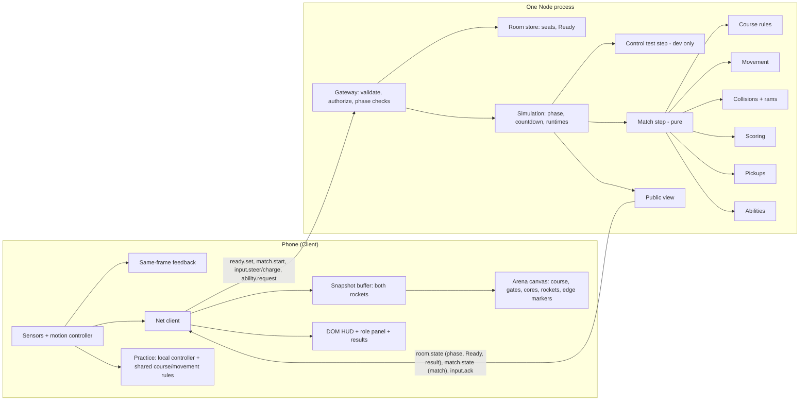
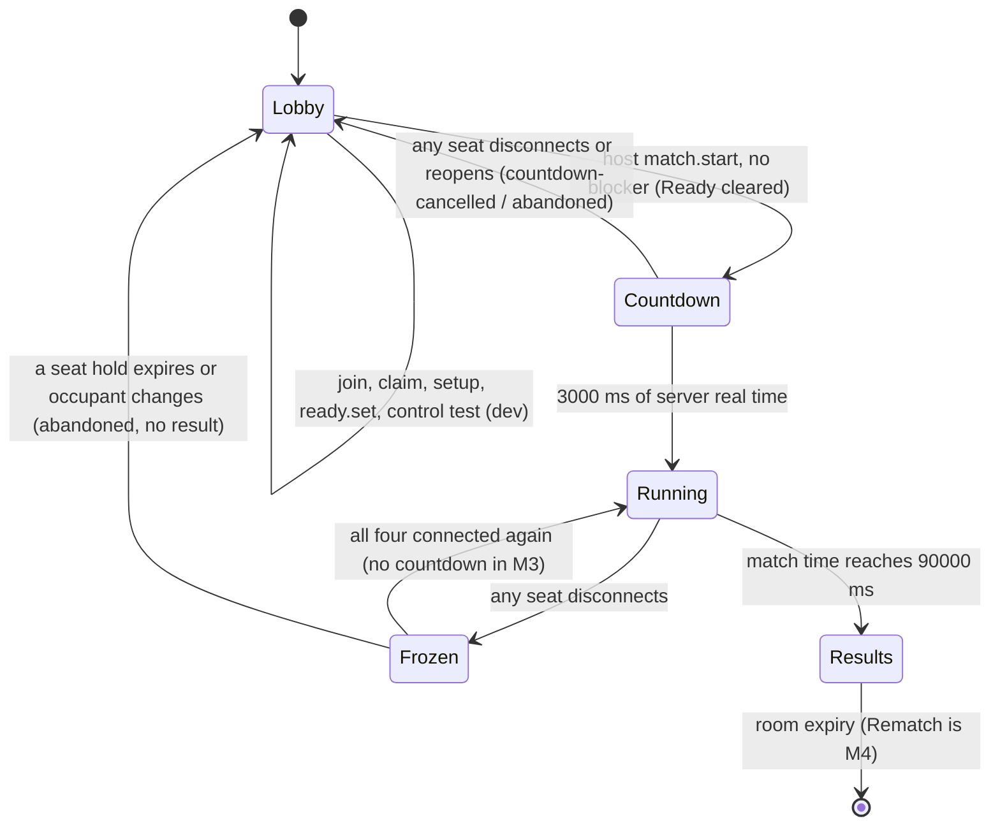

# Design Document: M3 Game Loop

## Overview

M3 turns the M2 shared-control proof into a complete four-player match. It adds:

- The Nova crew and rocket, the one PRD Section 4 rounded-ring course with wall containment and ordinary bumps, replacing the M2 inset-arena clamp.
- Ordered, forward, swept checkpoint scoring; four course cores; boosted rams, shields, and dropped cores with the PRD timing and tie rules.
- Ready, a host-only Start with a specific blocked reason, a 3-2-1-GO countdown on the server clock, a 90-second authoritative match, and a frozen result.
- On the phone: role practice with the tutorial copy, the match HUD, both rockets with full team identity, the chase camera with edge markers, a countdown overlay, and a results screen. The Watch view shows the full course with both rockets.

M3 reuses the M2 room store, seat rules, gateway, validator, public-view allowlist, fixed-step simulation, interpolator, crew view, motion controller, and the Pilot and Engineer panels. The pure-rule pattern stays: every rule takes explicit state, inputs, and time and returns new state.

Out of scope: pause/resume countdown, the Interrupted phase and screen, rematch, role swaps, lane alternation, full abuse regression (M4); Section 7.8 event bursts, sound, game-event haptics, detailed art, and the 16:9 spectator layout (M5).

### Key decisions

| ID | Decision | Rationale |
| --- | --- | --- |
| M3-1 | A disconnect or heartbeat timeout during a running match reuses the M2 freeze: no steps run, so match time, physics, effects, cooldowns, wall slows, and core timers stop; the disconnected Pilot's steering becomes 0. Reconnecting all four seats resumes at once, with no countdown. | PRD 8 freezes everything and drops stale steering. The 3-second resume countdown and per-seat deadline UI belong to M4 task 4.2. Reusing the M2 freeze keeps M3 honest without building M4. |
| M3-2 | Interim end paths until M4: a disconnect during the start countdown cancels it and returns to the lobby (PRD 8 rule). A seat that reopens (15 s hold expired) or changes occupant during the countdown or match discards the match with no result and returns to the lobby with the PRD line "Match interrupted. A player couldn't reconnect." | A frozen match with an empty seat can never resume, because seat claims are lobby-only. Returning to the lobby with no winner matches the PRD outcome (no winner, back to lobby). M4 replaces this with the Interrupted phase, its screen, and Back to lobby. |
| M3-3 | The M2 control test stays, dev-only behind the existing flag (`--dev` or `RR_CONTROL_TEST=1`). It runs only in the lobby phase, now flies on the real course with walls, and ends when a match is created. The lobby shows a "CONTROL TEST · not a match" button to Comet seats only when it runs. | Two-phone tuning stays possible without four phones. It never has a score, timer, or result, so it cannot become a two-player mode (PRD 1, M2 exit rule). |
| M3-4 | Practice runs only on the phone: a separate local-authority motion controller and the shared pure movement and course rules. Nothing about practice is sent. The Ready toggle unlocks after the first practice success; the server gates Ready on calibrated, as it cannot verify practice any more than calibration. | PRD 6: practice inputs do not affect match energy or scores. A client-only simulation cannot touch server state by construction. PRD 10 already accepts client-reported setup. |
| M3-5 | The Watch view shows the full course with a fixed letterboxed camera, both rockets, all cores, and both crews' next gates marked with team glyphs, plus the HUD. | PRD 7.6: Watch and spectator views always show the full course. The 16:9 spectator layout is M5. |
| M3-6 | The Simulation owns the room phase (`lobby`, `countdown`, `running`, `results`), the match runtime, the result, and the return reason. The Room_Store keeps seats, including the new Ready flag. | Phase changes happen inside the loop (countdown end, 90 s end), so the loop must own them. Seats stay in one place, as in M2. |
| M3-7 | Ready is per match: an accepted start clears all four Ready flags. Ready requires the seat to be occupied, connected, and calibrated, and any drop below that clears it. | PRD 7.7: Rematch returns with all Ready states cleared, and a cancelled countdown must recheck Ready. Clearing at start gives both for free. |
| M3-8 | Match time is integer milliseconds: step n starts at `floor(n × 1000 / SIMULATION_HZ)`. Steps run only while their start time is below 90000 ms; at 30 Hz the last step is n = 2699 and the match ends exactly at n = 2700. The countdown uses the server's monotonic real clock. | Exact-deadline rules (6 s, 8 s, 1 s, 90 s) need exact comparisons. `tick × 33.333…` floats can miss an exact boundary by one ulp. Every PRD duration is a whole number of 30 Hz steps. PRD clock domains put countdowns on real time. |
| M3-9 | While a wall slow is active, speed is 0.6 × base speed even if Boost is active. The Boost effect timer keeps running. | PRD 4 says "uses 60% of base speed for 0.4 s". Boost cannot be used to push through a wall contact. Proposed PRD clarification. |
| M3-10 | Gate crossings are tested on two segments per step: the movement segment (start to after wall containment) and the collision segment (after movement to after bump and re-containment). | The PRD order checks gates during movement. A bump that pushes a rocket across its next gate would otherwise never be swept, leaving that crew stuck behind a gate it has passed. Proposed PRD clarification. |
| M3-11 | A boosted ram is any new contact (the first overlapping step) while the attacker's Boost effect is active. The one-drop allowance is used only by an actual drop; a Shield block or a victim with no cores leaves it unused. A new Boost resets it. | PRD 4 states "a blocked hit does not consume the attacker's one-drop allowance" and is silent on an empty victim; nothing dropped, so nothing is used. Proposed PRD clarification. |
| M3-12 | Pickups use each rocket's straight segment from its start-of-step center to its end-of-step center. The contact time is the earliest fraction t in [0, 1] at which the center is within 31 units. Cores resolve greedily in increasing t, with capacity updated as cores are given; an exact t tie between two eligible rockets leaves the core that step. | Implements the PRD earliest-swept-contact and exact-tie rules deterministically, including a rocket that reaches two cores in one step near capacity. |
| M3-13 | Results are terminal in M3: the Results screen offers Leave room only. Rematch and Swap roles arrive in M4. | PRD 12 puts rematch in M4. A placeholder button would invent behavior. |
| M3-14 | No event stream in M3. Scores, pips, next gate, and core ownership come from snapshots. Section 7.8 bursts ("+25", BLOCKED, sparks) are M5. | Keeps the wire contract small; M5 can add `match.events` without changing snapshots. |
| M3-15 | A new `match-screen.ts` serves the countdown (as a full-screen overlay), the running match, and the frozen state. `control-screen.ts` stays for the dev control test. Shared crew input handling moves to `crew-controls.ts`. | One screen avoids remounting the canvas at GO. Extraction avoids duplicating the M2 input logic. |
| M3-16 | `match.state` becomes a union on `mode`: the unchanged control-test snapshot and the new match snapshot. The frozen result travels in `room.state`, so a reconnecting phone on Results gets it with the room. | Every device reads the same serialized result object (AC8). |
| M3-17 | Course data (walls, gates, spawns, lanes) are named constants in `src/shared/config.ts`; geometry functions live in `src/shared/course.ts`. Collisions get `rules/collisions.ts`; the implementation plan's `physics.ts` keeps movement only. | AGENTS.md: numbers in one config module. A separate collisions module keeps physics small and testable. |
| M3-18 | Drawing proportions (capsule, fins, dotted trail, marker shapes) are named constants in `arena-geometry.ts`, as in M2. UI sizes and timings (minimum core size, final warning, YOU tag, countdown numeral, marker sizes) go in `tokens.ts`. | Follows the M2 precedent and AGENTS.md token rule. |
| M3-19 | Recalibrate is available in the lobby, on setup, and while a match is frozen; it is hidden during the countdown and a live match. | PRD 6 allows recalibration before a match and during a connection pause. |

### Playtest observation

With identical straight flight from the start lanes, both rockets pass the top course core at (420, 106) at the same distance (28 units) and the same instant, every step. The PRD tie rule then leaves it uncollected until one pilot deviates. This follows PRD Section 4 exactly; it is flagged for the M3 four-phone playtest, not changed.

## Architecture



PR never talks to N: practice has no network path.

### Room phases



`Frozen` is the `running` phase with `frozen: true` on the wire. M4 adds `paused`, `resuming`, and `interrupted`.

### One match step

```mermaid
sequenceDiagram
    participant SIM as Simulation
    participant M as stepMatch (pure)
    SIM->>M: state, queued inputs (arrival order, with team)
    M->>M: 1. clear expired effects, expire dropped cores, respawn course cores (now = matchMs)
    M->>M: 2. steer / charge / select / activate per input (Boost activation resets drop allowance)
    M->>M: 3. per rocket: turn, move (boost or wall-slow speed), contain in course, gates on movement segment
    M->>M: 4. contact: separate; on new contact bump (+12, shield 25%), ram drops, re-contain, gates on collision segment
    M->>M: 5. pickups on start-to-end segments (dropped cores from this step excluded)
    M->>M: 6. tick + 1, matchMs = floor(tick × 1000 / 30); at 90000 complete + result
    M-->>SIM: next state, one result per input
    SIM-->>SIM: acks; match.state at ~18 Hz; on complete: results phase + room.state
```

### File layout

```text
src/shared/
  config.ts              [change] course, scoring, pickup, match, practice constants
  tokens.ts              [change] core min size, final warning, YOU tag, countdown, edge markers
  course.ts              [new] rounded-rect SDF, containment, clockwise tangent, gates, crossings
  protocol.ts            [change] ready.set, match.start, phases, match snapshot, result, reasons
  rules/physics.ts       [change] movement without the arena clamp; speed with boost and wall slow
  rules/collisions.ts    [new] contact, separation, bump, ram outcome
  rules/scoring.ts       [new] next gate, crossings, score, breakdown, result
  rules/pickups.ts       [new] course cores, dropped cores, timers, contested pickups
  rules/match.ts         [new] createMatch, stepMatch, matchMsAt, neutral steering
  rules/seats.ts         [change] Ready, clearReady, startBlocker
  rules/control-test.ts  [change] rocket state with wall slow; flies on the course
  copy.ts                [new] tutorial and results text built from config (shared so tests and PRD checks use one source)
server/
  validate.ts            [change] ready.set, match.start schemas
  rooms.ts               [change] setReady, clearReady
  simulation.ts          [change] match runtime, countdown, phases, freeze/abandon, results
  public-view.ts         [change] room phase, Ready, result, match snapshot, match acks
  dispatch.ts            [change] crew authorization, phase checks, ready.set, match.start
  websocket.ts, main.ts  [change] wire the simulation's room-change callback
src/client/
  room-context.ts        [change] phase, match snapshot union, per-team buffer, live match id
  net/interpolate.ts     [change] snapshots carry per-team poses
  flow.ts                [new] pure screen choice from phase, seat, setup, practice
  practice.ts            [new] pure ring progress and engineer checklist
  motion/controller.ts   [change] optional initial crew state for practice
  app.ts                 [change] practice, match, results screens; phase navigation
  ui/arena-geometry.ts   [change] capsule, fins, dots, round-rect path, edge markers
  ui/arena-canvas.ts     [change] course layer, gates, cores, two rockets, halo, YOU tag, markers
  ui/hud.ts              [new] scores, timer, pips, own-team marker
  ui/crew-controls.ts    [new] engineer/pilot input handling extracted from control-screen
  ui/match-screen.ts     [new] countdown overlay, HUD, chase arena, role panel, frozen note
  ui/practice-screen.ts  [new] tutorial, PRACTICE watermark, pilot rings or engineer steps, Skip
  ui/results-screen.ts   [new] headline, breakdown, explanation, Leave room
  ui/lobby-screen.ts     [change] Ready toggle, Start, blockers, notices, control test button
  ui/room-watch-screen.ts [change] full course, both rockets, HUD
  ui/setup-screen.ts     [change] go to practice or match after calibration
  ui/control-screen.ts   [change] use crew-controls; control-test snapshot only
  ui/copy.ts             [change] M3 copy and reason copy
docs/device-test-log.md  [change] M3 checklist and row template
rival-rockets-prd.md     [change] 7.9 M3 copy block; proposed Section 4/8 clarifications
```

## Components and Interfaces

Signatures are indicative; names may change during implementation if the meaning is kept.

### Shared: `course.ts`

```ts
export interface Vec { readonly x: number; readonly y: number }
export interface RoundRect { readonly minX: number; readonly minY: number; readonly maxX: number; readonly maxY: number; readonly radius: number }
// Exact signed distance to a rounded rectangle: negative inside (Inigo Quilez, "2D distance functions").
export function signedDistance(rect: RoundRect, p: Vec): number;
// Unit gradient of signedDistance; ties at the center break toward +x so it is deterministic.
export function gradient(rect: RoundRect, p: Vec): Vec;
export type WallId = 'outer' | 'inner';
export interface WallContact { readonly wall: WallId; readonly intoWall: Vec; readonly tangent: Vec }
export function isDrivable(p: Vec): boolean;           // sd(outer) ≤ −R and sd(inner) ≥ R
export function containPoint(p: Vec): { point: Vec; contact: WallContact | null };
export function containPose(pose: RocketPose, fallback: RocketPose): { pose: RocketPose; contact: WallContact | null };
export interface Gate { readonly index: 0 | 1 | 2 | 3; readonly a: Vec; readonly b: Vec; readonly forward: Vec }
export const GATES: readonly Gate[];                   // built from config GATE_SEGMENTS
export function crossesForward(gate: Gate, from: Vec, to: Vec): boolean;
```

- Containment: if `sd(outer, p) > −R`, move `p` by `−(sd + R) × ∇sd(outer)`; `intoWall = ∇sd(outer)`. If `sd(inner, p) < R`, move by `(R − sd) × ∇sd(inner)`; `intoWall = −∇sd(inner)`. The ring is 156–164 units wide, so the two corrections never conflict. The SDF is exact, so one projection lands on the boundary (within floating-point tolerance, which the property allows).
- Clockwise tangent (y down, positive angle clockwise on screen): outer wall `tangent = (−n.y, n.x)`; inner wall `tangent = (n.y, −n.x)`, where `n = intoWall`. At the top of the ring both give `(1, 0)` (right), at the right side `(0, 1)` (down).
- `containPose`: non-finite `x` or `y` returns `fallback` (the crew's start lane) with no contact. After containment, if `dot(headingVector, intoWall) > 0`, the heading becomes `atan2(tangent)`. Otherwise it is kept.
- `crossesForward`: side `s(p) = (p − a) · forward`. A crossing needs `s(from) ≤ 0 < s(to)` and the intersection point's coordinate along the gate inside `[a, b]` inclusive. Ending exactly on the line (`s(to) = 0`) does not score; the next forward move from there does.

### Shared: `rules/physics.ts` (changed)

```ts
export interface RocketPose { readonly x: number; readonly y: number; readonly heading: number } // unchanged
export interface RocketState { readonly pose: RocketPose; readonly steering: number; readonly wallSlowUntilMs: number | null }
export function normalizeHeading(rad: number): number;             // unchanged
export function forwardSpeed(boosted: boolean, wallSlowed: boolean): number; // wall slow wins (M3-9)
export function turnAndMove(pose: RocketPose, steering: number, speed: number, dtMs: number): RocketPose;
export function stepRocket(rocket: RocketState, boosted: boolean, nowMs: number, dtMs: number, fallback: RocketPose):
  { rocket: RocketState; segment: { from: Vec; to: Vec }; contact: WallContact | null };
export function createStartPose(team: TeamId, lanes: LaneAssignment): RocketPose;
```

`stepRocket` sanitizes steering and `dtMs` as in M2, moves, then calls `containPose`. A contact sets `wallSlowUntilMs = nowMs + WALL_SLOW_MS`; the slow applies while `nowMs < wallSlowUntilMs`. The M2 inset-arena clamp is removed. The control test keeps its state shape but swaps `pose` for `RocketState`, so it flies on the course.

### Shared: `rules/collisions.ts`

```ts
export interface ContactBodies { readonly comet: RocketPose; readonly nova: RocketPose }
export interface ContactOutcome {
  readonly comet: RocketPose; readonly nova: RocketPose;
  readonly overlapping: boolean;   // stored as the match's contact flag
  readonly bumped: boolean;        // first overlapping step
  readonly impact: Vec | null;     // midpoint at contact, before separation
}
export function resolveContact(bodies: ContactBodies, wasInContact: boolean, shielded: Record<TeamId, boolean>): ContactOutcome;
export type RamOutcome = 'drop' | 'blocked' | 'none';
export function ramOutcome(attackerBoosting: boolean, allowanceUsed: boolean, victimShielded: boolean, victimCarried: number): RamOutcome;
```

- Overlap when center distance `d < 2R`. Separation moves each center `(2R − d) / 2` apart along the center line (coincident centers separate along +x/−x, deterministic).
- On `bumped`, each rocket moves a further `BUMP_DISPLACEMENT`, or `BUMP_DISPLACEMENT × SHIELD_BUMP_MULTIPLIER` when that rocket's crew is shielded. Headings are unchanged.
- The caller re-contains both rockets with `containPose`; a contact there is a wall contact (slow and redirect), so "up to 12" holds when a wall stops the push.
- `ramOutcome`: `drop` only when boosting, allowance unused, victim unshielded, and victim carries ≥ 1; `blocked` when boosting, allowance unused, and victim shielded; otherwise `none`. Evaluated once per direction per bump, so two boosting unshielded crews can each lose one core.

### Shared: `rules/scoring.ts`

```ts
export function nextGateIndex(crossings: number): 0 | 1 | 2 | 3;          // crossings mod CHECKPOINT_COUNT
export function advanceCrossings(crossings: number, from: Vec, to: Vec): number; // at most CHECKPOINT_COUNT per segment
export interface ScoreBreakdown { crossings: number; checkpointPoints: number; carried: number; corePoints: number; total: number }
export function teamScore(crossings: number, carried: number): number;
export function breakdown(crossings: number, carried: number): ScoreBreakdown;
export interface MatchResult { readonly outcome: 'win' | 'draw'; readonly winner: TeamId | null; readonly teams: Record<TeamId, ScoreBreakdown> }
export function matchResult(crews: Record<TeamId, { crossings: number; carried: number }>): MatchResult;
```

`advanceCrossings` checks only the next gate, increments on a forward crossing, and rechecks the following gate on the same segment (bounded loop; geometrically a step never spans two gates, but the function does not rely on it). There is no lap bonus and no subtraction path.

### Shared: `rules/pickups.ts`

```ts
export interface CourseCoreState { readonly spawn: 0 | 1 | 2 | 3; readonly respawnAtMs: number | null } // null = available
export interface DroppedCoreState {
  readonly id: number; readonly x: number; readonly y: number; readonly owner: TeamId;
  readonly createdTick: number; readonly ownerUnlockAtMs: number; readonly expiresAtMs: number;
}
export function createCourseCores(): CourseCoreState[];
export function expireAndRespawn(course: readonly CourseCoreState[], dropped: readonly DroppedCoreState[], nowMs: number):
  { course: CourseCoreState[]; dropped: DroppedCoreState[]; expired: number };
export function contactTime(from: Vec, to: Vec, core: Vec, radius: number): number | null; // earliest t in [0,1]
export interface PickupInput {
  readonly paths: Record<TeamId, { from: Vec; to: Vec }>;
  readonly carried: Record<TeamId, number>;
  readonly course: readonly CourseCoreState[];
  readonly dropped: readonly DroppedCoreState[];
  readonly tick: number; readonly nowMs: number;
}
export interface PickupOutput {
  readonly carried: Record<TeamId, number>; readonly course: CourseCoreState[]; readonly dropped: DroppedCoreState[];
  readonly collected: ReadonlyArray<{ readonly team: TeamId; readonly core: { kind: 'course'; spawn: number } | { kind: 'dropped'; id: number } }>;
}
export function resolvePickups(input: PickupInput): PickupOutput;
```

- `expireAndRespawn` removes dropped cores with `nowMs ≥ expiresAtMs` and makes course cores with `nowMs ≥ respawnAtMs` available. It runs first in the step, so expiry wins over a pickup at exactly 6 s and a respawn is collectible at exactly 8 s.
- `contactTime` solves `|from + t(to − from) − core| = radius` for the smallest root in [0, 1]; a start inside the radius gives 0; a zero-length path gives 0 or null.
- `resolvePickups`: candidates are (core, team, t) for available course cores and dropped cores with `createdTick < tick`, skipping the owner while `nowMs < ownerUnlockAtMs`. Process cores in order of their earliest candidate t (ties between cores by kind then spawn or id). For one core: drop candidates whose team is now full; if the two remaining earliest t are equal, leave the core; otherwise give it to the earliest. A course pickup sets `respawnAtMs = nowMs + COURSE_CORE_RESPAWN_MS`; a dropped pickup removes the dropped core.

### Shared: `rules/match.ts`

```ts
export type LaneAssignment = 'comet-upper' | 'comet-lower';
export interface CrewMatchState {
  readonly rocket: RocketState;
  readonly abilities: CrewAbilityState;  // deadlines in match ms
  readonly crossings: number;
  readonly carried: number;
  readonly dropAllowanceUsed: boolean;
}
export interface MatchState {
  readonly matchId: number;
  readonly tick: number;
  readonly matchMs: number;                 // matchMsAt(tick)
  readonly lanes: LaneAssignment;           // 'comet-upper' in M3
  readonly crews: Readonly<Record<TeamId, CrewMatchState>>;
  readonly course: readonly CourseCoreState[];
  readonly dropped: readonly DroppedCoreState[];
  readonly inContact: boolean;
  readonly nextDroppedId: number;
  readonly complete: boolean;
  readonly result: MatchResult | null;
}
export type MatchInput = QueuedInput & { readonly team: TeamId };  // QueuedInput from control-test.ts
export function matchMsAt(tick: number): number;                  // Math.floor(tick * 1000 / SIMULATION_HZ)
export function createMatch(matchId: number, lanes?: LaneAssignment): MatchState;
export function stepMatch(state: MatchState, inputs: readonly MatchInput[]): { state: MatchState; results: InputResult[] };
export function withNeutralSteering(state: MatchState, team: TeamId): MatchState;
```

`stepMatch` follows the step diagram. Details:

- `now = matchMsAt(tick)`, `dt = matchMsAt(tick + 1) − now`.
- Inputs apply to `input.team`'s crew, in arrival order, with the M2 ability functions. A successful activation of Boost sets `dropAllowanceUsed = false`.
- Boost and Shield flags for movement and collisions read `getAbilityStatus(abilities, now).activeAbility` after the input phase, as in M2.
- Ram drops are evaluated for both directions on `bumped`. Each `drop` decrements the victim's `carried`, sets the attacker's `dropAllowanceUsed`, and appends a dropped core at `containPoint(impact)` with `createdTick = tick`, `ownerUnlockAtMs = now + OWNER_RECLAIM_DELAY_MS`, `expiresAtMs = now + DROPPED_CORE_LIFETIME_MS`.
- A completed state (`complete: true`) is returned unchanged with every input rejected as `not-running`, so no path can score after the end.
- After the tick increment, `matchMs ≥ MATCH_DURATION_MS` sets `complete` and `result = matchResult(crews)`.

### Shared: `rules/seats.ts` (extended)

```ts
export interface SeatSlot { /* M2 fields */ readonly ready: boolean }
export function setReady(s: SeatsState, participantId: string, ready: boolean): SeatResult; // not-seated, not-calibrated
export function clearReady(s: SeatsState): SeatsState;
// StartStep and StartBlocker live in protocol.ts so the client and shared copy can use them.
export interface SeatReadiness { readonly seat: SeatId; readonly occupied: boolean; readonly connected: boolean; readonly setup: SetupStatus; readonly ready: boolean }
export function seatReadiness(s: SeatsState): SeatReadiness[];          // server adapter, SEAT_IDS order
export function startBlocker(seats: readonly SeatReadiness[]): StartBlocker | null; // { seat, step } with step 'join' | 'reconnect' | 'calibrate' | 'ready'
```

`setSeatSetup` below calibrated, `setConnected(false)`, release, watch, and removal all produce `ready: false`. `setReady(…, false)` is always allowed for a seated participant. `startBlocker` walks the seats in `SEAT_IDS` order and returns the first seat that is open (join), held or disconnected (reconnect), not calibrated (calibrate), or not Ready (ready). Taking a plain readiness list lets the lobby run the same function on `room.state.seats`, so the server's refusal and the Start button's reason never disagree.

### Shared: `copy.ts`

```ts
export function pilotTutorial(): string;    // PRD 4 text from CHECKPOINT_POINTS, CORE_POINTS
export function engineerTutorial(): string; // from CHARGE_ENERGY, ABILITY_COST, ABILITY_DURATION_MS, SHARED_COOLDOWN_MS
export function gatesLine(b: ScoreBreakdown): string;  // "Gates: 3 × 25 = 75"
export function coresLine(b: ScoreBreakdown): string;  // "Cores held: 2 × 10 = 20"
export const RESULTS_NOTE: string;                     // "Gate points stay. Core points reflect what you hold at the finish."
export function startBlockerText(b: StartBlocker): string; // "Waiting for Nova Engineer to calibrate"
```

Durations render in whole seconds ("2 seconds", "3-second"). A unit test compares the output with the PRD Section 4 strings.

### Shared: `protocol.ts` (extended)

```ts
export type RoomPhase = 'lobby' | 'countdown' | 'running' | 'results';
export type ReturnReason = 'countdown-cancelled' | 'abandoned';
export type StartStep = 'join' | 'reconnect' | 'calibrate' | 'ready';
export interface StartBlocker { readonly seat: SeatId; readonly step: StartStep }
export interface PublicScoreBreakdown { readonly crossings: number; readonly checkpointPoints: number; readonly carried: number; readonly corePoints: number; readonly total: number }
// ClientMessage adds:
//   { type: 'ready.set'; requestId: number; ready: boolean }
//   { type: 'match.start'; requestId: number }
// RejectReason adds: 'wrong-phase' | 'not-host' | 'start-blocked' | 'not-calibrated' | 'not-running'
export interface PublicSeat { /* M2 */ readonly ready: boolean }
export interface RoomStateMessage { /* M2 */ readonly phase: RoomPhase; readonly result: PublicMatchResult | null; readonly returnReason: ReturnReason | null }
export type MatchStateMessage = ControlTestStateMessage | MatchSnapshotMessage; // discriminated by mode
export interface MatchSnapshotMessage {
  readonly type: 'match.state'; readonly mode: 'match'; readonly matchId: number;
  readonly phase: 'countdown' | 'running' | 'complete'; readonly tick: number; readonly matchMs: number;
  readonly remainingMs: number; readonly countdownRemainingMs: number; readonly frozen: boolean;
  readonly rockets: Readonly<Record<TeamId, PublicPose>>;
  readonly crews: Readonly<Record<TeamId, PublicMatchCrew>>;
  readonly courseCores: readonly { readonly available: boolean }[];     // index = spawn
  readonly droppedCores: readonly PublicDroppedCore[];
}
export interface PublicMatchCrew extends PublicCrewState { readonly crossings: number; readonly nextGate: number; readonly carried: number; readonly score: number }
export interface PublicDroppedCore { readonly id: number; readonly x: number; readonly y: number; readonly owner: TeamId; readonly lockRemainingMs: number; readonly lifeRemainingMs: number }
export interface PublicMatchResult { readonly matchId: number; readonly outcome: 'win' | 'draw'; readonly winner: TeamId | null; readonly teams: Readonly<Record<TeamId, PublicScoreBreakdown>> }
```

The existing control-test snapshot type is renamed `ControlTestStateMessage`; consumers narrow on `mode`. Adding the new client types and reasons forces small changes in exhaustive consumers (validator schemas, dispatch switch, reject-copy map, room-state builder). The protocol task makes those compile with the real validator schemas and temporary refusals and placeholders, which later tasks replace.

`match.rematch` and `match.swap` stay absent (`unknown-type`). The `controlTestEnabled` and `activeMatchId` fields of `room.state` stay.

### Server: `validate.ts`

Adds `'ready.set': { requestId: counter, ready: boolean }` and `'match.start': { requestId: counter }`. The `boolean` check accepts only `true` and `false` and otherwise returns `invalid-value`. The M2 check order and exact-field rule are unchanged.

### Server: `rooms.ts`

Adds `setReady(code, participantId, ready): StoreResult` and `clearReady(code)`, both through `seats.ts`. Ready changes refresh `lastActivityMs` (accepted room action). Disconnect clears the seat's Ready through `setConnected`.

### Server: `simulation.ts`

One runtime per room, `ControlTestRuntime | MatchRuntime`:

```ts
interface MatchRuntime {
  kind: 'match'; phase: 'countdown' | 'running' | 'results';
  state: MatchState; queue: Array<{ input: MatchInput; connectionId: string }>;
  frozen: boolean; countdownEndsAtMs: number; accumulatorMs: number; lastLoopMs: number; nextBroadcastMs: number;
  readonly crew: Readonly<Record<SeatId, string>>;   // occupants at start
}
export interface SimulationDeps { /* M2 */ roomChanged(code: string): void } // loop-driven phase changes
export interface RuntimeInfo {
  readonly mode: 'control-test' | 'match'; readonly matchId: number;
  readonly phase: RoomPhase; readonly frozen: boolean; readonly accepting: boolean;
  readonly result: MatchResult | null;
}
interface Simulation {
  sync(code: string, seats: SeatsState): LifecycleChange;
  startMatch(code: string, seats: SeatsState): number;      // caller has checked host, phase, blocker
  enqueue(code: string, connectionId: string, input: QueuedInput | MatchInput): RejectReason | null;
  current(code: string): RuntimeInfo | null;
  phase(code: string): RoomPhase;                            // 'lobby' without a match runtime
  returnReason(code: string): ReturnReason | null;
  tick(): void;
  remove(code: string): void;
}
```

- One `nextMatchId` counter for control tests and matches (Requirement 15.8).
- `startMatch` ends a control test (rejecting its queue as `stale-match`), creates the match, sets `countdownEndsAtMs = now + START_COUNTDOWN_MS`, clears the return reason, and broadcasts the first snapshot.
- `tick()`: a countdown runtime broadcasts at the M2 cadence and, at `now ≥ countdownEndsAtMs`, becomes `running` with a fresh accumulator. A running, unfrozen runtime steps as in M2. A step that completes the match sets `phase = 'results'`, broadcasts a final snapshot, and calls `deps.roomChanged(code)`.
- `sync()` for a match runtime: any start occupant different from the seat's occupant → discard, `returnReason = 'abandoned'` (countdown or running); in countdown, any seat disconnected → discard, `countdown-cancelled`; in running, any seat disconnected → freeze (neutral steering for disconnected Pilots, queue rejected `not-running`, one frozen snapshot); all connected and frozen → resume. Results ignore seat changes.
- A control test starts only while `phase(code) === 'lobby'` and the flag is on.

### Server: `dispatch.ts`

- Input authorization: for a match, the bound seat's role must match the input (Pilot → `input.steer`, Engineer → `input.charge`/`ability.request`) and its team becomes `input.team`. For a control test, the M2 Comet-only map stays. Checks run in the M2 order, then `accepting` (running and not frozen; else `not-running`), then `matchId`, then `seq`.
- Phase checks before mutation: `seat.claim`, `ready.set`, `setup.update` only in `lobby`; `seat.release` and `room.watch` rejected in `countdown` and `running`; `room.leave` always allowed.
- `match.start`: host (`not-host`), phase (`wrong-phase`), `startBlocker` (`start-blocked`), then `simulation.startMatch`, `rooms.clearReady`, and a room broadcast.
- `ready.set`: phase, then `rooms.setReady` (`not-seated`, `not-calibrated`).
- `toRoomState` receives the runtime info and return reason.

### Server: `public-view.ts`

Adds `toMatchSnapshot(runtime, nowMs)`, `toMatchAck(state, team, result)`, `toPublicResult(result, matchId)`, and the new room fields, all field by field. Steer acks carry the sender crew's rocket pose; crew acks carry that crew's `PublicCrewState`. Remaining durations are `max(0, deadline − matchMs)`; the countdown remaining time uses the server real clock.

### Client: `room-context.ts` and `net/interpolate.ts`

- `phase` getter from `room.state`; `liveMatchId` is set only while `phase === 'running'`, the snapshot is a running match, and it is not frozen (or, in the lobby, for a running unfrozen control test as in M2).
- The crew view follows the seat's own crew: `crews[seatTeam(seat)]` for a match, `crew` for the control test.
- `Snapshot.poses: Partial<Record<TeamId, PublicPose>>`; `sampleAt` interpolates each team present in both neighbor snapshots with the M2 `interpolatePose`. Session time is `sessionMs` (control test) or `matchMs` (match). The buffer resets on a new match id, a frozen change, or a phase change.

### Client: `flow.ts`

```ts
export function screenForPhase(phase: RoomPhase, seated: boolean, current: ScreenName): ScreenName | null;
```

Returns `match` for seated players in `countdown`/`running` (unless on `setup`, which continues to `match` after calibration), `results` for everyone in `results`, `lobby` for seated players on `match`/`results`/`practice` when the phase becomes `lobby` (practice stays in `lobby`), and `null` when no navigation is needed. Watchers stay on `room-watch` except for `results`.

### Client: `practice.ts` and `ui/practice-screen.ts`

```ts
export interface PilotPractice { readonly rocket: RocketState; readonly ringsDone: number; readonly firstSuccess: boolean }
export function stepPilotPractice(p: PilotPractice, steering: number, nowMs: number, dtMs: number): PilotPractice;
export type EngineerStep = 'charge' | 'select-shield' | 'activate' | 'done';
export interface EngineerPractice { readonly charges: number; readonly step: EngineerStep; readonly firstSuccess: boolean }
export function reduceEngineerPractice(p: EngineerPractice, event: ControllerEvent): EngineerPractice;
```

- Pilot: the ghost starts at the seat crew's start lane and moves with `stepRocket` on the course at base speed. Ring k completes when the swept center passes within `PRACTICE_RING_RADIUS` of `PRACTICE_RINGS[k]` and rings `0..k−1` are done.
- Engineer: a second controller `createMotionController('engineer', { authority: 'local', initialCrew })` with `PRACTICE_START_ENERGY`. Accepted charges count up to `PRACTICE_CHARGE_GOAL`; then a Shield selection; then a successful activation.
- The screen shows the role's Tutorial_Copy, the PRACTICE watermark, the ghost arena (fixed full course) or the M2 engineer panel fed by the practice controller, and Skip after the first success. Done or Skip returns to the lobby and records `practiced[seat] = true` in app memory. The screen receives no net client.

### Client: screens

| Screen | Behavior |
| --- | --- |
| Lobby | M2 layout plus: seat states Open/Taken/Calibrated/Ready (check icon)/Disconnected; Ready toggle for a seated, calibrated, practiced player (`ready.set`); Host Start button disabled with the blocker text; non-host blocker text or "Waiting for the host to start"; return notice (polite live region); "A match is running. Watch it?" with Watch when phase ≠ lobby; dev control test button for Comet seats when a control test runs. |
| Setup | M2 steps. After Set neutral: `practice` in the lobby phase, `match` in countdown/running. |
| Practice | Tutorial, PRACTICE watermark, role practice, Skip after first success, then lobby. |
| Match | HUD, chase arena (own crew), role panel. Countdown overlay with 3/2/1 from `countdownRemainingMs`, role reminder, GO for `COUNTDOWN_NUMERAL_MS` after running. Frozen note "Paused · [Seat] reconnecting" (assertive) with Recalibrate. Wake lock held. |
| Results | Headline (team color + silhouette, or DRAW), per-team gates/cores/total lines, results note, Leave room; polite announcement. |
| Watch | Room code, seats, HUD, fixed full course with both rockets, cores, both next gates with team glyphs; waiting text when nothing runs. |
| Control (dev) | M2 behavior, opened from the lobby button; reads only control-test snapshots. |

### Client: `ui/hud.ts`

```ts
export function formatTimer(remainingMs: number): string;  // "MM:SS", seconds rounded up: 90000 → "01:30", 1 → "00:01", 0 → "00:00"
export function isFinalWarning(remainingMs: number): boolean; // remainingMs ≤ FINAL_WARNING_MS
export function createHud(ownTeam: TeamId | null): { element: HTMLElement; update(m: MatchSnapshotMessage, nowMs: number): void; destroy(): void };
```

Scores, timer, and pips are DOM text with tabular figures. Pips are five spans with filled/empty state and an accessible label ("Comet cores 2 of 5"). The pulse is a CSS class toggled when the displayed second changes; under reduced motion only the color changes.

### Client: `ui/arena-geometry.ts` and `ui/arena-canvas.ts`

Geometry additions (pure, tested in Node): `capsulePoints`, `finPoints`, `trailDots(lengthPx, boosted)`, `roundRectPath(rect, scale)`, `gateSegment(gate)`, and:

```ts
export interface MarkerObject { readonly kind: 'opponent' | 'gate' | 'core'; readonly x: number; readonly minY: number; readonly maxY: number }
export interface EdgeMarker { readonly kind: MarkerObject['kind']; readonly edge: 'top' | 'bottom'; readonly x: number }
export function edgeMarkers(fit: ViewFit, boxW: number, boxH: number, objects: readonly MarkerObject[]): EdgeMarker[];
```

The visible world y-range is `[−offsetY / scale, (boxH − offsetY) / scale]`. An object with `maxY` above it gets a top marker; `minY` below it a bottom marker; `x` is `object.x × scale + offsetX` clamped to `[EDGE_MARKER_INSET_PX, boxW − EDGE_MARKER_INSET_PX]`.

Canvas changes:

- The offscreen arena layer adds the track surface (outer minus inner rounded rect, `--bg-track`) and both walls (`--line-wall`), drawn once per resize.
- Per frame: gates (idle dashed, viewer's next gate solid `--gate-next`; on Watch, both next gates solid with team glyph labels), course and dropped cores (magenta, `max(26 × scale, MIN_CORE_CSS_PX)`), dropped-core draining ring and owner glyph while locked, both rockets from pre-rendered sprites (Comet arrowhead, Nova capsule + fins, same length), Comet chevron and Nova dotted trails, M2 boost/shield effects for both, the own-rocket white halo, the YOU tag for `YOU_TAG_MS`, and edge markers in chase mode.
- `drawScene(scene)` replaces per-call arguments: `{ rockets, effects, cores, dropped, nextGates, ownTeam, matchMs, camera focus }`. `draw` and `drawPose` stay for the M1 sensor test and the control test.
- No per-frame `shadowBlur`; sprites carry the glow, as in M2.

## Data Models

### Server-private records

| Record | Fields | Invariants |
| --- | --- | --- |
| `SeatSlot` (Room) | M2 fields + `ready` | `ready` ⇒ occupied ∧ connected ∧ calibrated. |
| `MatchRuntime` | `phase`, `state: MatchState`, `queue`, `frozen`, `countdownEndsAtMs`, `accumulatorMs`, `lastLoopMs`, `nextBroadcastMs`, `crew` (start occupants) | Exists from start until room deletion or discard. Steps only in `running` and not frozen. Result fixed once set. |
| `MatchState` | see `rules/match.ts` | `tick ≥ 0`; `matchMs = matchMsAt(tick)`; `complete` ⇔ `matchMs ≥ 90000`; each `carried` in 0..5; crossings nondecreasing. |
| `CrewMatchState` | `rocket`, `abilities`, `crossings`, `carried`, `dropAllowanceUsed` | Energy 0..100. Totals are derived, never stored. |
| `CourseCoreState` | `spawn`, `respawnAtMs` | Available ⇔ `respawnAtMs === null`. |
| `DroppedCoreState` | `id`, `x`, `y`, `owner`, `createdTick`, `ownerUnlockAtMs`, `expiresAtMs` | Position in the Drivable_Region; removed on pickup or expiry. |
| Return reason (per room) | `ReturnReason \| null` | Set on cancel/abandon; cleared on the next start. |

### Public messages (M3 additions)

| Message | Fields |
| --- | --- |
| `ready.set` (client) | `requestId`, `ready` |
| `match.start` (client) | `requestId` |
| `room.state` | M2 fields + `phase`, `seats[].ready`, `result`, `returnReason` |
| `match.state` (mode `match`) | `matchId`, `phase`, `tick`, `matchMs`, `remainingMs`, `countdownRemainingMs`, `frozen`, `rockets.{comet,nova}`, `crews.{comet,nova}` (crew state + `crossings`, `nextGate`, `carried`, `score`), `courseCores[].available`, `droppedCores[]` |
| `input.ack` | M2 shapes; steer acks carry the sender crew's pose, crew acks carry the sender crew |
| `request.rejected` | M2 shape with the new reasons |

### Constants

Shared (`src/shared/config.ts`), PRD values unless marked M3:

| Constant | Value |
| --- | --- |
| `OUTER_WALL`, `INNER_WALL` | `{ minX: 24, minY: 24, maxX: 576, maxY: 776, radius: 120 }`, `{ minX: 180, minY: 188, maxX: 420, maxY: 612, radius: 80 }` |
| `GATE_SEGMENTS` | top `(300,24)–(300,188)` forward `(1,0)`; right `(420,400)–(576,400)` `(0,1)`; bottom `(300,612)–(300,776)` `(−1,0)`; left `(24,400)–(180,400)` `(0,−1)` |
| `CHECKPOINT_COUNT`, `CHECKPOINT_POINTS`, `CORE_POINTS` | 4, 25, 10 |
| `CORE_SPAWNS` | `(420,106)`, `(498,300)`, `(300,694)`, `(102,500)` |
| `CORE_DIAMETER`, `CORE_PICKUP_RADIUS`, `MAX_CARRIED_CORES` | 26, 31, 5 |
| `COURSE_CORE_RESPAWN_MS`, `DROPPED_CORE_LIFETIME_MS`, `OWNER_RECLAIM_DELAY_MS` | 8000, 6000, 1000 |
| `WALL_SPEED_MULTIPLIER`, `WALL_SLOW_MS` | 0.6, 400 |
| `BUMP_DISPLACEMENT`, `SHIELD_BUMP_MULTIPLIER`, `MAX_DROPS_PER_BOOST` | 12, 0.25, 1 |
| `MATCH_DURATION_MS`, `START_COUNTDOWN_MS` | 90000, 3000 |
| `START_LANES` | existing `comet` (240, 78) and `nova` (240, 134), heading 0 |
| `PRACTICE_RINGS`, `PRACTICE_RING_RADIUS` | M3: `(460,106)`, `(498,360)`, `(380,694)`; 40 |
| `PRACTICE_START_ENERGY`, `PRACTICE_CHARGE_GOAL` | M3: 0, 2 |

Tokens (`src/shared/tokens.ts`): `MIN_CORE_CSS_PX = 14`, `FINAL_WARNING_MS = 10000`, `YOU_TAG_MS = 5000` (alias of `HINT_DURATION_MS`), `COUNTDOWN_NUMERAL_MS = 1000`, `EDGE_MARKER_SIZE_PX = 20` (M3), `EDGE_MARKER_INSET_PX = 14` (M3), `OWN_HALO_PX = 2` (M3).

No new server-only constants. Countdown and match broadcasts reuse `BROADCAST_INTERVAL_MS` and `MAX_CATCH_UP_STEPS`.

## Correctness Properties

*A property is a characteristic or behavior that should hold true across all valid executions of a system-essentially, a formal statement about what the system should do. Properties serve as the bridge between human-readable specifications and machine-verifiable correctness guarantees.*

Each property is one fast-check test of at least 100 runs against the pure modules (or the socket-free dispatch and simulation with injected clocks). Criteria classified as examples, edge cases, or smoke checks are covered in the Testing Strategy. Floating-point comparisons use a small named tolerance in the test file.

### Property 1: Containment keeps rocket centers on the course

*For any* pose, including positions inside the inner island, outside the outer wall, and non-finite values, `containPose` returns finite coordinates and heading with the center in the Drivable_Region; for a finite center outside the region, the returned center is the nearest Drivable_Region boundary point and a wall contact is reported; for a non-finite coordinate, the fallback start pose is returned.

**Validates: Requirements 2.1, 2.2, 2.6, 2.7**

### Property 2: Containment is idempotent

*For any* pose already in the Drivable_Region, `containPose` returns the same pose and no contact; *for any* pose, containing the result a second time returns it unchanged with no contact.

**Validates: Requirements 2.8**

### Property 3: Wall contacts redirect only headings into the wall

*For any* pose outside the Drivable_Region, after containment the heading equals the clockwise wall tangent when the input heading pointed into the wall, and equals the input heading otherwise; the tangent at every boundary point has a positive dot product with the clockwise ring direction at that point (right on the top lane, down on the right, left on the bottom, up on the left).

**Validates: Requirements 2.3, 2.4**

### Property 4: Speed follows Boost and the wall slow

*For any* rocket state far enough from the walls that one step makes no contact, any boost flag, any wall-slow deadline, and any step time, the distance moved equals `speed × dt`, where speed is `0.6 × 120` while the slow is active (`now < wallSlowUntilMs`), else `1.5 × 120` when boosted, else 120; *for any* wall contact at time `t`, the slow is active exactly for step times in `[t, t + 400)`.

**Validates: Requirements 2.5, 3.1, 3.2, 3.3**

### Property 5: Turning follows steering; neutral keeps heading

*For any* rocket state that makes no wall contact in the step, steering `s` in `[−1, 1]`, and step time `dt`, the heading change equals `normalizeHeading(s × 120° × dt)` with positive clockwise on screen, and with `s = 0` the heading is unchanged.

**Validates: Requirements 3.4, 3.5**

### Property 6: One crew's inputs never touch the other crew's controls

*For any* match state and any input batch addressed only to team A, the resulting team B steering, energy, selected ability, effect, and cooldown equal those from stepping the same state with no inputs.

**Validates: Requirements 4.4**

### Property 7: Bumps separate and displace within limits

*For any* two overlapping rocket poses away from the walls, `resolveContact` leaves the centers at least `2R` apart (within tolerance) along the original center line; when `wasInContact` is false each rocket moves by its separation share plus 12 units (3 units when its crew is shielded); when `wasInContact` is true each moves by its separation share only; headings never change; no rocket moves more than its separation share plus 12 units.

**Validates: Requirements 5.1, 5.2, 5.3, 5.4, 5.7**

### Property 8: Match steps keep rockets, gates, and cores valid

*For any* match state and sequence of input batches, after every step both rocket centers are in the Drivable_Region, each crew's Valid_Crossings is at least its previous value, each crew's Carried_Cores is between 0 and 5, and a crew's Carried_Cores decreases only in a step where that crew suffered a Boosted_Ram drop.

**Validates: Requirements 5.5, 5.6, 6.8, 7.8**

### Property 9: Gate crossings match the ordered forward model

*For any* polyline path of rocket centers, starting from any crossing count, `advanceCrossings` applied segment by segment yields the same count as a reference model that lists every forward crossing of any gate segment in path order (using `s(from) ≤ 0 < s(to)` and the inclusive segment span) and keeps only those matching the expected gate in turn; backward crossings, repeated crossings of a scored gate, skipped gates, and endpoints exactly on a line add nothing, and four valid crossings add exactly four (no lap bonus).

**Validates: Requirements 6.2, 6.3, 6.4, 6.6, 6.7**

### Property 10: Contact time is the earliest entry into the pickup radius

*For any* segment and core point, `contactTime` returns null when no point of the segment is within 31 units; otherwise it returns `t` in `[0, 1]` such that the point at `t` is within 31 units (within tolerance) and no point at a smaller parameter is, with `t = 0` when the segment starts inside the radius.

**Validates: Requirements 7.2**

### Property 11: Pickups go to the earliest eligible rocket

*For any* pickup input (paths, carried counts, course and dropped cores with arbitrary owners, lockouts, and creation ticks), `resolvePickups` gives each core to at most one team; every collection is by a team that was below 5 at that moment, not the locked owner, for a core that is available and not created in this step; the winner's contact time is strictly earlier than every other eligible team's; and every eligible-but-uncollected core had an exact contact-time tie or only ineligible contacts.

**Validates: Requirements 7.3, 7.4, 7.5, 8.8, 8.9**

### Property 12: Core timers fire on the exact step

*For any* collection or drop step `k` in a 30 Hz match, a collected Course_Core is unavailable in steps whose time is below `matchMsAt(k) + 8000` and available, before pickups, from the first step at or after it; a Dropped_Core is present in steps whose time is below `matchMsAt(k) + 6000` and removed, before pickups, from the first step at or after it, even when a rocket touches it in that step.

**Validates: Requirements 7.6, 7.7, 8.10**

### Property 13: Cores are conserved

*For any* match state and input batch, the change in (Comet Carried_Cores + Nova Carried_Cores + number of Dropped_Cores) over one step equals the number of Course_Cores collected in that step minus the number of Dropped_Cores expired in that step.

**Validates: Requirements 7.9**

### Property 14: Ram outcomes follow boost, allowance, shield, and cargo

*For any* combination of attacker boosting, allowance used, victim shielded, and victim carried count, `ramOutcome` returns `drop` exactly when the attacker is boosting, the allowance is unused, the victim is unshielded, and the victim carries at least one core; `blocked` exactly when the attacker is boosting, the allowance is unused, and the victim is shielded; and `none` otherwise.

**Validates: Requirements 8.1, 8.3, 8.4**

### Property 15: At most one drop per Boost activation

*For any* sequence of match steps with arbitrary contacts, Boost and Shield activations, and carried counts, the number of cores a crew loses to the opponent's rams between two consecutive opponent Boost activations is at most 1, a blocked or empty-victim ram never uses the allowance, and the allowance is unused again after each Boost activation.

**Validates: Requirements 8.2, 8.6, 8.11**

### Property 16: Dropped cores land on the course at the impact

*For any* boosted bump that drops a core, the Dropped_Core's position equals `containPoint` of the midpoint of the two centers at contact and lies in the Drivable_Region, with lockout and expiry deadlines 1000 ms and 6000 ms after the step time.

**Validates: Requirements 8.7**

### Property 17: The integer match clock lands on exact boundaries

*For any* tick `n ≥ 0`, `matchMsAt(n)` is a nonnegative integer, `matchMsAt(n + 1) > matchMsAt(n)`, and for every PRD duration `D` in {400, 1000, 2000, 3000, 6000, 8000} at 30 Hz, `matchMsAt(n + D × 30 / 1000) = matchMsAt(n) + D`; `matchMsAt(2700) = 90000` and `matchMsAt(2699) < 90000`.

**Validates: Requirements 9.2**

### Property 18: Each match step advances one tick and answers every input

*For any* running match state and input batch, `stepMatch` returns `tick + 1`, `matchMs = matchMsAt(tick + 1)`, exactly one result per input in arrival order with the input's sequence number, each applied or rejected with a reason, and deep-equal output when called twice with the same arguments.

**Validates: Requirements 9.3, 9.4, 9.5**

### Property 19: Completed matches never change

*For any* completed match state and input batch, `stepMatch` returns a state deep-equal to the input and rejects every input with `not-running`; *for any* sequence of steps from a running state, no state with `matchMs ≥ 90000` is followed by a different score or result.

**Validates: Requirements 13.2, 13.4**

### Property 20: Scores and results follow the formula

*For any* nonnegative crossings and carried counts in 0..5 per team, `teamScore = 25 × crossings + 10 × carried`; the breakdown's checkpoint points plus core points equal its total; `matchResult` reports `win` with the higher-total team when totals differ and `draw` with no winner when they are equal.

**Validates: Requirements 6.6, 10.1, 10.2, 10.3, 10.4, 10.6**

### Property 21: Ready implies a live, calibrated seat

*For any* sequence of claim, release, watch, leave, setup, connect, disconnect, ready, and clear-ready operations, after every operation each Ready seat is occupied, connected, and calibrated; `setReady(true)` on an uncalibrated seat is rejected with `not-calibrated` and leaves the state unchanged.

**Validates: Requirements 11.1, 11.2, 11.3, 11.6**

### Property 22: The start blocker is the first missing step

*For any* seats state, `startBlocker` returns null exactly when all four seats are occupied, connected, calibrated, and Ready; otherwise it returns the first seat in `SEAT_IDS` order that is not, with the step `join`, `reconnect`, `calibrate`, or `ready` for the first condition that fails; the lobby copy for that blocker names that seat and step.

**Validates: Requirements 11.4, 11.5, 24.3**

### Property 23: Only the host starts a ready lobby

*For any* room with any seat state and phase, and any sender binding, dispatching `match.start` creates a match if and only if the sender is the Host, the phase is `lobby`, and `startBlocker` is null; otherwise it returns `not-host`, `wrong-phase`, or `start-blocked` (checked in that order) and leaves room, seat, and simulation state unchanged.

**Validates: Requirements 12.1, 12.2, 12.3, 12.4**

### Property 24: Crew inputs are authorized per seat, team, and phase

*For any* connection binding (none, watcher, unseated, any seat), gameplay input type, room phase, frozen flag, match id, and sequence history, a match input is queued only when the phase is `running`, the match is not frozen, the bound seat's role matches the input type, the match id is current, and the sequence is fresh; a queued input carries the bound seat's team, so steering reaches only that crew's rocket.

**Validates: Requirements 12.7, 13.4, 15.4, 15.5, 15.6**

### Property 25: Rejected messages change nothing

*For any* store, simulation, and phase state, and any message that fails validation, rate limiting, membership, role, phase, host, blocker, match, or sequence checks, dispatching it leaves the serialized room state, seats including Ready, match state, queue, and last-activity time identical, and produces exactly one rejection.

**Validates: Requirements 15.7, 15.9**

### Property 26: The validator stays total with the new types

*For any* frame, including `ready.set` and `match.start` with arbitrary field values and extra fields, `validateMessage` returns a typed message or a reason without throwing; `ready` is accepted only as a boolean; `match.rematch` and `match.swap` yield `unknown-type`.

**Validates: Requirements 15.2**

### Property 27: Public match state never leaks private data

*For any* reachable room, control test, and match runtime with arbitrary tokens, connection ids, IP strings, limiter state, and hold deadlines, the JSON of `toRoomState`, `toMatchSnapshot`, `toMatchAck`, and `toPublicResult` contains none of those values and only allowlisted keys.

**Validates: Requirements 16.4, 16.5**

### Property 28: The HUD shows the snapshot

*For any* match snapshot, the HUD view model shows each team's score, filled pip count, and Next_Gate exactly as in the snapshot, and the timer text equals `formatTimer(remainingMs)`.

**Validates: Requirements 16.6**

### Property 29: Frozen matches do not advance

*For any* running match and any frozen interval of Server_Clock time, the match state (tick, match time, poses, effects, cooldowns, wall slows, course and dropped core timers) after the interval is deep-equal to the state when it froze, apart from the disconnected Pilot's steering set to 0.

**Validates: Requirements 14.2**

### Property 30: Pilot practice rings complete in order

*For any* sequence of steering values and frame times, the ghost stays in the Drivable_Region, `ringsDone` never decreases or exceeds 3, ring `k` completes only after rings `0..k−1`, and `firstSuccess` becomes true exactly when the first ring completes.

**Validates: Requirements 17.2, 17.5, 17.8**

### Property 31: Engineer practice steps complete in order

*For any* sequence of local controller events, the practice step advances only charge → select-shield → activate → done, the charge step completes after exactly `PRACTICE_CHARGE_GOAL` accepted charges, and `firstSuccess` becomes true at the first accepted charge.

**Validates: Requirements 17.3, 17.5**

### Property 32: Results lines match the breakdown

*For any* score breakdown, `gatesLine` reads "Gates: c × 25 = p" and `coresLine` reads "Cores held: k × 10 = q" with `c`, `p`, `k`, `q` equal to the breakdown's crossings, checkpoint points, carried, and core points.

**Validates: Requirements 18.4, 23.3**

### Property 33: Both rockets interpolate between snapshots

*For any* buffer of match snapshots with both teams' poses and any render time inside the buffer, `sampleAt` returns for each team a pose on the segment between that team's neighboring poses with heading on the shorter arc, and the newest pose of each team past the end of the buffer.

**Validates: Requirements 20.10**

### Property 34: Edge markers appear exactly for off-screen objects

*For any* chase fit, box size, and list of objects, `edgeMarkers` returns one marker for each object whose vertical extent lies entirely above (edge `top`) or below (edge `bottom`) the visible world range, none for objects at least partly visible, each with the object's kind and an `x` within `[EDGE_MARKER_INSET_PX, boxW − EDGE_MARKER_INSET_PX]`.

**Validates: Requirements 21.1, 21.2, 21.4, 21.5**

## Error Handling

| Situation | Server behavior | Client behavior (proposed copy, to add to PRD 7.9) |
| --- | --- | --- |
| `ready.set` while not calibrated | `request.rejected not-calibrated` | Ready stays hidden; developer log only (the client hides the toggle) |
| `ready.set`, `seat.claim`, `setup.update` outside the lobby | `wrong-phase` | Claim: "A match is running. Watch it?" with Watch; setup updates ignored |
| `seat.release`, `room.watch` during countdown or match | `wrong-phase` | Buttons hidden in those phases |
| `match.start` by a non-host | `not-host` | Start button not shown; "Waiting for the host to start" |
| `match.start` with a blocker | `start-blocked` | Button disabled with "Waiting for [Seat] to [join / reconnect / calibrate / get ready]" (PRD 7.7, 7.9 pattern) |
| `match.start` outside the lobby | `wrong-phase` | No copy (button not shown) |
| Gameplay input in countdown, frozen, or results | Rejected ack `not-running` | No copy; the client stops sending once it sees the phase |
| Gameplay input from the wrong role, a watcher, or unseated | Rejected ack `not-authorized` | Developer-only |
| Input for an ended control test or old match | `stale-match` | Developer-only |
| Disconnect in countdown | Countdown cancelled, room to lobby, `returnReason: countdown-cancelled` | Lobby notice "Countdown stopped. A player disconnected." |
| Disconnect in a running match | Match frozen, disconnected Pilot's steering 0 | "Paused · Nova Engineer reconnecting" (PRD 7.9) with Recalibrate; assertive live region |
| Seat hold expires or occupant changes in countdown or match | Match discarded, no result, `returnReason: abandoned` | Lobby notice "Match interrupted. A player couldn't reconnect." (PRD 7.7 copy) |
| Disconnect, leave, or reconnect in results | Result unchanged | Results stay on screen |
| `match.rematch`, `match.swap` | `unknown-type` | Developer-only (no UI sends them in M3) |
| Exception in a match step | Caught by the loop; the runtime is discarded as `abandoned`, logged without identifiers | Lobby notice as above |

New player copy (all proposed, PRD 7.9 "Game loop (Milestone 3)" block): "Ready", "Not ready", "Start match", "Waiting for [Seat] to get ready" (PRD), "Waiting for [Seat] to calibrate" (PRD), "Waiting for [Seat] to reconnect", "Waiting for a [Seat]", "Waiting for the host to start", "A match is running. Watch it?", "Countdown stopped. A player disconnected.", "Match interrupted. A player couldn't reconnect." (PRD), "PRACTICE", "Skip", "Fly through the rings", "Ring [n] of 3", "Shake to charge", "Tilt right and hold for Shield", "Tap Activate", "Practice done", "Back to lobby", "Tilt to steer" / "Shake to charge" (PRD countdown reminders), "GO", "YOU", "COMET WINS", "NOVA WINS", "DRAW", "Total", "Leave room", "Paused · [Seat] reconnecting" (PRD). The tutorial and results text are PRD Section 4 copy generated from config.

## Testing Strategy

### Tools

- Vitest (existing), colocated `*.test.ts`, `environment: 'node'`.
- fast-check 4.10.2 (already pinned) used directly: `fc.assert(fc.property(...), { numRuns: 100 })` or more. No custom PBT framework and no new dependency.
- Injected clocks (`nowMs`) and outbound callbacks for the simulation and dispatch, as in M2; the `ws` client for in-process integration tests on port 0.

### Property tests

- One test per property above, at least 100 runs each, tagged `// Feature: m3-game-loop, Property N: <property title>`.
- Generators: poses across the whole 600 × 800 arena and beyond (including the inner island, corners, NaN, ±Infinity); polyline paths that loop forward, reverse, wiggle across one gate, and end exactly on gate lines; overlapping rocket pairs with shield and boost flags; pickup inputs with ties built by mirroring paths; random match input batches per team (steer, charge, select, activate) over many steps; seat operation sequences including Ready; arbitrary JSON for the validator; random chase fits and object lists.
- Long match runs in properties use a bounded number of steps (for example up to 600) so the suite stays fast; the 90-second boundary is covered by unit tests.

### Unit tests (examples and edge cases)

- Config and tokens values (1.1–1.3). `GATES` coordinates and directions (6.1).
- `createMatch`: lanes, both crews' energy and Boost, four available cores, `comet-lower` swap (4.1–4.3, 7.1).
- Course: wall slow at 399/400 ms; the control test rocket flown into a wall stays on the course (2.5, 3.6, 26.3).
- Step order: dropped core expiring at exactly 6000 ms is not collected; course core respawning at exactly 8000 ms is collected that step; owner reclaims at exactly 1000 ms but not 999 ms; Boost activated in a step moves at 1.5× that step; a bump across the next gate scores; both boosting unshielded crews each drop one core; repeated contacts within one Boost drop one core; mirrored paths tie on a core and leave it; a full rocket leaves a core for the other (6.5, 7.4, 7.7, 8.5, 9.1).
- Lap wrap: eight crossings make two laps and 200 points (6.3).
- 90-second boundary: step 2699 runs and step 2700 completes the match; the result breakdown matches the scores; a tie gives DRAW (13.3, 10.2, 10.3).
- Simulation with a fake clock: countdown at 2999/3000 ms; countdown snapshots; freeze on disconnect and resume without countdown keep the same match id; countdown disconnect cancels to lobby; seat hold expiry abandons; results unchanged after disconnect; a match ends a control test; one id counter (12.6, 12.8, 13.1, 14.1, 14.3–14.6, 15.8, 26.1, 26.4).
- Dispatch: accepted start clears Ready; `ready.set` paths; phase rejections per request type (12.5, 15.7).
- Validator: `ready.set`, `match.start` shapes; rematch/swap `unknown-type` (15.1, 15.3).
- Public view: room and match snapshot keys; remaining durations (13.5, 16.1–16.3).
- Copy: tutorial and results text equal PRD Section 4 with default config; paused line; countdown labels at 3000, 2001, 2000, 1, 0; headline for win/draw; return notices; waiting text (14.7, 18.2, 18.3, 22.1–22.3, 23.2, 24.6, 25.4).
- HUD: `formatTimer` at 90000, 61000, 10000, 1, 0; `isFinalWarning` at 10000/10001 (19.2, 19.4).
- Flow: exhaustive `screenForPhase` table, including reconnect mid-match via setup and practice after calibration (17.1, 23.1, 24.5, 24.7).
- Practice isolation: the practice module imports nothing from `net/`; the crew view is unchanged after practice events (17.6, 17.7).
- Lobby helpers: seat state label and Ready toggle visibility; Recalibrate visibility per phase (19.9, 24.1, 24.2, 24.4).
- Geometry: capsule, fins, trail dots counts and boost doubling (20.3).
- Update the M2 tests that assumed the inset-arena clamp (M2 Properties 19 and 20 and control-test expectations) to the course rules.

### Integration tests (in-process server)

- Four `ws` clients join, claim all seats, report calibrated, set Ready; a non-host start is rejected; the host start yields `countdown`, then `running` snapshots with both rockets; a steer from each Pilot moves only its own rocket; a charge from each Engineer changes only its own crew.
- With fake time or a shortened run in the test harness only (no production constant change), the match reaches `results` and every client receives the same `room.state.result`.

### Smoke checks

`npm run lint`, `npm test`, `npm run build`; `npm start`, `/healthz`, and a WebSocket connect to `/ws` (27.3). `render.yaml` unchanged (27.5).

### Manual verification (cannot be done by agents)

Needs four physical phones, including at least one iPhone (Safari) and one Android phone (Chrome), plus an optional fifth device. Record in `docs/device-test-log.md` without names, room codes, tokens, IPs, device identifiers, or raw sensor data.

- [ ] Four phones join by QR or code and claim four unique seats; a fifth device watches.
- [ ] Each player completes motion setup and practice (pilot rings; engineer two charges, Shield, Activate); PRACTICE watermark and Skip after the first success; practice does not change the lobby or the match.
- [ ] The tutorial text matches PRD Section 4.
- [ ] With three players, an uncalibrated player, a disconnected player, or a player not Ready, the host's Start is disabled with the specific reason (AC2 foundation).
- [ ] 3-2-1-GO appears on all four phones with the role reminder.
- [ ] Both pilots steer with real tilt and both engineers charge with real shakes; each crew controls only its own rocket (AC3).
- [ ] Gates score only in order and forward; driving backward or circling one gate scores nothing (AC6).
- [ ] Cores: pickups, five-core cap, respawn, boosted ram drop, Shield block, owner lockout, dropped-core expiry; all phones agree on ownership and score (AC7).
- [ ] Walls slow the rocket and never trap it; bumps push without taking points.
- [ ] Chase camera keeps the own rocket at a fixed height; edge markers show the opponent, next gate, and cores off screen and are readable; reduced motion shows the full course.
- [ ] Grayscale: the two rockets, scores, and ability states stay distinguishable (AC13 foundation).
- [ ] At 90 s every phone shows the same result and breakdown; a tie shows DRAW (AC8).
- [ ] Turn off Wi-Fi on one phone for under 15 s: the match freezes with the paused line, then resumes. Over 15 s: all phones return to the lobby with the interrupted notice. Disconnect during the countdown: back to the lobby.
- [ ] Rotate a phone mid-match: overlay, Pilot steering neutral, Engineer selection frozen.
- [ ] Record p95 send-to-applied-ack and render delay from the debug panel during a four-phone match (AC12 foundation).

## Open Questions for the User

1. **Interim end of a match after a lost seat (M3-2).** Until M4, a 15-second hold expiry during a match returns everyone to the lobby with no result and the PRD interrupted line. Acceptable as the M3 stand-in for the Interrupted screen?
2. **Rule clarifications to record in the PRD as proposed (M3-9 to M3-12).** Wall slow overrides Boost; bump displacement can score a gate; an empty-victim ram does not use the drop allowance; pickup sweep uses the start-to-end segment. Approve, or prefer a different reading?
3. **Practice gating (M3-4).** Ready unlocks after the first practice success on the phone; the server checks only calibration. Acceptable, or should the server track a "practiced" status?
4. **Results without Rematch (M3-13).** Playing again in M3 means creating a new room. Acceptable until M4?
5. **New copy.** Approve the proposed M3 copy in Error Handling before it moves from proposed to final in PRD 7.9.
6. **Top-core tie (Playtest observation).** Keep the PRD tie rule as is for the first four-phone playtest?
