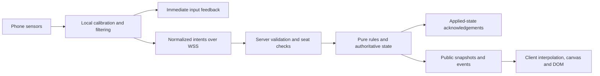

# Rival Rockets implementation plan

Based on [PRD v1.1](../rival-rockets-prd.md), dated October 24, 2026, and [AGENTS.md](../AGENTS.md).

**Status: planning only.** The repository currently contains the PRD and project rules; there is no application, chosen stack, dependency manifest, build command, or test runner. The tree and schemas below are proposed implementation boundaries, not generated code or validated behavior. The PRD remains the source of truth.

## 1. Scope and decisions

Build one browser game for exactly four active players: Comet Pilot, Comet Engineer, Nova Pilot, and Nova Engineer. Use one 2D course, server-authoritative gameplay, in-memory rooms, and optional spectators. Support the PRD's Watch recovery paths with a read-only shared arena view; the dedicated large-screen spectator presentation belongs to optional M5 work. No database schema, accounts, matchmaking, extra roles, extra courses, native app, or 3D engine is needed.

Confirm the stack before scaffolding and record the decision in `AGENTS.md`. Until then, `<ext>` below means the extension appropriate to the selected language/framework; it does not imply TypeScript, React, or any particular server runtime. Create each file only when its milestone needs it.

### Questions to resolve before dependent implementation

Resolve these questions with the user before the dependent implementation. Record product decisions in the PRD; do not silently assign missing values or behavior. Any rule change must also update tutorial and results explanations.

| ID | Question | Needed before |
| --- | --- | --- |
| D1 | Which client language/framework, server runtime, build/test tools, and HTTPS/WSS host should be used? | Scaffolding in M1. |
| D2 | What measured dead zone, smoothing, maximum tilt, shake threshold/filter, and stable selection hold duration should be adopted? Portrait is the current requirement; any orientation change needs real-device evidence and a PRD update. | M1 control tuning; confirm measured settings before carrying them forward. |
| D3 | What are the display-name length limit and counting rule, room-code length, message byte limit, heartbeat interval, and room/input rate limits? What activity refreshes room expiry? The PRD requires these limits but does not specify all values. | Public room transport in M2. |
| D4 | What are the exact course geometry, fixed core count/locations, base speed, turn rate, boost multiplier, wall slowdown, collision bounds, and shield displacement reduction? How are simultaneous pickup/collision conflicts resolved? | M2 movement tuning and M3 course/gameplay. |
| D5 | How should the pilot receive the engineer's currently selected ability before activation? Section 7.6 requires it, but Section 9 describes only steering, charge events, and ability requests. What is the initial selection? | M2 shared crew status. Confirm a selection intent within ability requests or another explicit protocol rule before implementation. |
| D6 | How are role swaps requested/accepted, and which setup/readiness steps must be repeated after a swap or reconnect? How are readiness and host controls handled between results and a rematch? | M4 rematch/reconnect flow. The four-player start gate and lane alternation remain mandatory. |
| D7 | What should happen when a second seat disconnects during a pause or resume countdown, and when several deadlines coincide? | M4 failure-path tests. Preserve the specified 15-second seat hold and no-winner interruption rule. |

## 2. Proposed file tree

`[M1]` through `[M5]` indicate the first milestone that needs a file, not when all work on it is finished. This is one repository, without a workspace/package layer or generic framework of services.

```text
Rival-Rockets/
|-- AGENTS.md                         Existing rules; record confirmed stack here
|-- rival-rockets-prd.md              Product source of truth
|-- docs/
|   |-- implementation-plan.md       This plan
|   |-- device-test-log.md            [M1] Devices, versions, observations, measurements
|   `-- deployment.md                 [M1] HTTPS/WSS deployment and restart behavior
|-- README.md                         [M1] Setup and actual build/lint/test commands
|-- .gitignore                        [M1] Outputs, local config, secrets
|-- <manifest and lockfile>           [M1] Selected stack; exact dependency versions
|-- <build, lint, and test config>    [M1] Only configuration required by that stack
|-- public/
|   `-- fonts/                       [M5] Space Grotesk, Inter, and their licenses
|-- src/
|   |-- shared/
|   |   |-- config.<ext>              [M1] Named gameplay, motion, and network constants
|   |   |-- design-tokens.<ext>       [M1] One token source for DOM and canvas
|   |   |-- schema.<ext>              [M2] Public state and message contracts
|   |   |-- course.<ext>              [M3] One course: walls, forward gates, spawns, cores
|   |   `-- rules/
|   |       |-- seats.<ext>           [M2] Membership, role ownership, start eligibility
|   |       |-- physics.<ext>         [M2] Movement, containment, collisions
|   |       |-- abilities.<ext>       [M2] Charge, energy, effects, shared cooldown
|   |       |-- scoring.<ext>         [M3] Ordered forward gates and score calculation
|   |       |-- pickups.<ext>         [M3] Course cores, drops, reclaim and expiry
|   |       `-- match.<ext>           [M3] Game step, clock, results; pause/reset in M4
|   |-- server/
|   |   |-- main.<ext>                [M2] Start server and connect transport to rooms
|   |   |-- rooms.<ext>               [M2] In-memory state, seats, private tokens, expiry
|   |   |-- websocket.<ext>           [M2] Origin, validation, limits, dispatch, acks
|   |   `-- simulation.<ext>          [M2] Fixed steps, broadcast timing, public snapshots
|   `-- client/
|       |-- main.<ext>                [M1] App entry, screen flow, visibility/wake lock
|       |-- styles.css               [M1] Portrait layout, safe areas, accessible controls
|       |-- socket.<ext>              [M2] WSS lifecycle, inputs, acks, snapshot buffer
|       |-- arena.<ext>               [M2] Interpolated arena; isolated practice in M3
|       |-- feedback.<ext>            [M5] Visual events; optional sound/haptics and mute
|       |-- motion/
|       |   |-- sensors.<ext>         [M1] Permissions, usable readings, sensor lifecycle
|       |   `-- controls.<ext>        [M1] Neutral tilt, filtering, shake, selection lock
|       |-- screens/
|       |   |-- motion-setup.<ext>    [M1] Enable, check, calibrate, recover
|       |   |-- practice.<ext>        [M3] Isolated role practice, no match mutations
|       |   |-- home-join.<ext>       [M2] Create/join, name/code validation
|       |   |-- lobby.<ext>           [M2] Four seats, code/link/QR, ready/start status
|       |   |-- match.<ext>           [M2] DOM HUD/role panels over the canvas
|       |   |-- results.<ext>         [M3] Winner/draw and breakdown; rematch/swap in M4
|       |   `-- spectator.<ext>       [M5] Optional 16:9 arena, crew panels, event ticker
|       `-- ui/
|           |-- hud.<ext>             [M2] Scores, timer, core pips, crew identity
|           |-- role-panel.<ext>      [M1] Pilot gauge or engineer meter/selection/activate
|           `-- status-overlay.<ext>  [M1] Rotation/errors; countdown/pause/interruption later
`-- tests/
    |-- motion.test.<ext>             [M1] Filtering/lock logic; cannot validate hardware
    |-- seats.test.<ext>              [M2] Unique seats, role permissions, start gate
    |-- abilities.test.<ext>          [M2] Charge/cost/effect/cooldown boundaries
    |-- physics.test.<ext>            [M2] Wall containment and collision behavior
    |-- transport.test.<ext>          [M2] Validation, origin, unauthorized/replayed inputs
    |-- scoring.test.<ext>            [M3] Forward ordered crossings and totals
    |-- pickups.test.<ext>            [M3] Ownership, capacity, drop/respawn timing
    `-- match.test.<ext>              [M3] Deadline/results; pause/reconnect/rematch in M4
```

Small fixtures can live beside their tests. Do not add fixture factories, a generic event bus, a database layer, an asset pipeline, or separate packages until the implementation actually requires them. Optional audio assets and the dedicated spectator screen are added only if used. M1 uses a simple DOM sensor indicator and role panel, not a practice course or match simulation.

### Module boundaries

| Boundary | Responsibility |
| --- | --- |
| Client motion | Keep raw sensor samples and calibration local. Produce capped steering and discrete charge/ability intents; update local feedback immediately. |
| Client rendering | Interpolate server snapshots. Render HUD and controls as DOM; draw the arena on canvas. Never decide scoring, energy, collisions, or pickup ownership. |
| Shared pure rules | Take explicit state, validated input, and elapsed time; return next state and events. No sockets, browser APIs, storage, randomness, or implicit clocks inside rule functions. |
| Server transport | Authenticate each connection's current seat, validate and rate-limit messages, pass intents to rules, and return applied-state acknowledgements. |
| Server orchestration | Own room memory, private credentials, server time, simulation, reconnect deadlines, and public serialization. Supply time and identifiers to pure rules. |

The server may use the shared rule modules; clients importing types or practice helpers does not grant clients authority. Keep server-private schemas beside `rooms.<ext>`, outside the public schema. Copy only explicitly allowed fields into broadcasts.



## 3. Schema structure

These are logical records, not SQL tables or a commitment to a serialization library. Names and wire shapes are proposed. Persist neither rooms nor matches; discard their data at expiry or restart. Never transmit raw motion or reconnect tokens in public snapshots, links, QR codes, or diagnostics.

### 3.1 Types and ownership

| Type | Values / constraints |
| --- | --- |
| `TeamId` | `comet` or `nova`. |
| `Role` | `pilot` or `engineer`. |
| `SeatId` | The fixed four combinations of team and role; never arbitrary additional seats. |
| `Ability` | `boost` or `shield`; initial selection awaits D5. |
| `RoomPhase` | `lobby`, `countdown`, `running`, `paused`, `resuming`, `results`, `interrupted`. |
| `ParticipantId`, `MatchId`, `CoreId` | Server-issued temporary identifiers, scoped to the live room/match as appropriate. No account identity. |
| `RoomCode` | Human-readable, excludes `0/O` and `1/I/L`; length/alphabet details await D3. Public locator, never a seat credential. |
| `Vector2` | Finite numeric `x`, `y` in course coordinates. Units/bounds are defined with D4. |
| `Steering` | Finite numeric value clamped to `[-1, 1]` by the server; neutral is `0`. |
| `Sequence` | Bounded integer for matching an input to its acknowledgement and suppressing replay on its connection. |

### 3.2 Server-private room and connection records

| Record | Fields | Invariants |
| --- | --- | --- |
| `RoomState` | `code`, `phase`, `hostParticipantId`, `participants`, `seats`, optional `match`, `lastActivityRealMs` | Exactly four available seat slots; at most four occupants. One room owns its temporary data. |
| `ParticipantState` | `id`, `displayName`, `joinIntent: play/watch`, optional active `connectionId`, `lastHeartbeatRealMs` | Names bounded by D3 and rendered as text. Watching participants cannot claim seats or send gameplay inputs. Unseated play participants may choose an open role. |
| `SeatState` | `id`, optional `occupantId`, `setupStatus`, `ready`, private `reconnectToken`, optional `reconnectDeadlineRealMs` | At most one occupant per seat and one seat per participant. One active connection per occupied seat. Token is unguessable and independent of room code. |
| `ConnectionState` | `id`, optional bound room/participant/seat, input sequence tracking, rate-limit counters | Socket membership, not a client-supplied team/role, determines authority. Private state is never serialized into public views. |

`setupStatus` distinguishes unverified, readings confirmed, and calibrated. It reflects client-reported setup progress; it is not cryptographic proof of physical motion. The honest client cannot report successful setup or enable Ready without usable readings and calibration. The server still checks membership, connection state, setup status, and readiness before starting. Sensor spoofing remains outside the MVP's anti-cheat scope (PRD Section 10).

Seat ownership is the source of truth for team/role lookup. Host status grants start/rematch controls, not permission to control another seat. Host transfer in the lobby follows Section 8. Reconnection and role swaps must not leave old credentials capable of controlling a newly occupied seat; resolve the exact swap/reset flow under D6.

### 3.3 Authoritative match records

| Record | Fields | Invariants |
| --- | --- | --- |
| `MatchState` | `id`, `tick`, `elapsedMatchMs`, `countdownRemainingMs`, starting lane assignment, `crews`, `courseCores`, `droppedCores`, optional `result` | Two crews, one course. Gameplay time advances only while running. No scoring after the match deadline. |
| `CrewState` | `team`, `rocket`, `validCheckpointCrossings`, `carriedCores`, `energy`, `nextChargeAtMatchMs`, `abilityState`, selected ability status after D5 | Carried cores in `0..5`, energy in `0..100`. Totals are derived, not independently mutable fields. |
| `RocketState` | `position`, `heading`, current movement state needed by the chosen physics, normalized pilot steering | Server-only movement decisions. The simulation retains the previous step's position for gate crossing/collision detection. Neutral input preserves heading. |
| `AbilityState` | optional active ability, `effectEndsAtMatchMs`, `cooldownEndsAtMatchMs`, `boostDropUsed` | One shared cooldown. A new boost resets its one-drop allowance. Failure spends nothing. Shield blocks core drops and reduces bumps, not walls. |
| `CourseCoreState` | `id`, fixed spawn reference, optional `respawnAtMatchMs` | Available or waiting to respawn. At capacity, collection does not consume the core or start a respawn. |
| `DroppedCoreState` | `id`, `position`, `originalOwner`, `ownerUnlockAtMatchMs`, `expiresAtMatchMs` | Either crew can collect once; original owner is locked out for the first second. Remove on pickup or expiry. |
| `MatchResult` | `outcome: win/draw/interrupted`, optional `winnerTeam`, frozen per-team breakdown | Winner exists only for a completed unequal-score match. Draw and interruption have no winner. |
| `ScoreBreakdown` | `validCheckpointCrossings`, `checkpointPoints`, `carriedCores`, `corePoints`, `total` | `total = 25 * validCheckpointCrossings + 10 * carriedCores`; no lap bonus. |

The next checkpoint derives from valid crossings modulo the four ordered gates. Accept a crossing only when it is the expected gate and the swept movement is forward through that gate. Keep prior crossing state if the chosen geometry needs it to avoid jitter at the line; do not award points merely for touching a gate. Course geometry contains gate segments and forward normals, wall boundaries, two equal-progress starting lanes, and fixed core spawns.

Compute score and breakdown from crossings and currently held cores using shared constants. A core loss changes only the core contribution. Keep the completed result fixed while the results screen is open.

### 3.4 Clock domains and transitions

| Clock | Runs during a pause? | Uses |
| --- | --- | --- |
| Server monotonic real time | Yes | Heartbeat detection, 15-second reconnect holds, room inactivity expiry, network limits, start/resume countdowns. |
| Server match time | No | 90-second match, physics, charge/ability cooldowns, active effects, respawns, dropped-core reclaim and expiry. |
| Client local time | Yes | Input feedback, interpolation, and send-to-applied-ack measurement; never authoritative gameplay decisions. |

Use remaining durations when exposing server deadlines to clients; do not require synchronized device clocks. Advance only the permitted portion of a final simulation step so a late tick cannot score beyond 90 seconds.

```text
lobby -> countdown -> running -> results
                         |
                         v
                       paused -> resuming -> running
                         |
                         v
                    interrupted -> lobby

results -> rematch setup/readiness -> countdown
```

Start requires all four seats connected, calibrated, and ready. A disconnect or heartbeat timeout immediately freezes gameplay and clears stale steering. Reconnect restores the private seat; resume requires all four connected and a three-second countdown. Expiry interrupts with no winner. The Interrupted screen offers Back to lobby. A rematch creates fresh match state and alternates starting lanes while respecting role swaps. D6/D7 resolve transitions not fully specified by the PRD.

### 3.5 Client-local records

| Record | Fields / purpose | Never authoritative for |
| --- | --- | --- |
| `MotionSetup` | Permission outcome, usable-reading flag, neutral calibration, latest filter state, current orientation | Membership, match readiness validation on the server, physics. Raw samples remain transient on this client. |
| `ControlState` | Normalized steering, shake detector/cooldown, selected ability, pending stable tilt, shake-selection lock | Energy, cooldown completion, successful activation. |
| `PracticeState` | Ghost movement, ring progress, practice-only energy/ability state | Any live match score, energy, or pickup. |
| `ClientSession` | Own participant/seat, private reconnect credential, local screen, latest public room state | Other seats or host privileges. Never share its token via URLs or logs. |
| `RenderState` | Small snapshot buffer, interpolation progress, transient feedback events | Collision, checkpoint, pickup, or result decisions. |
| `PendingInput` | Sequence and local send time until the matching applied/rejected acknowledgement | Server time or admission decisions. |

On rotation, show "Turn your phone upright", send neutral pilot steering, and block engineer selection changes. Do not rely on orientation lock. Recalibration is available before play and during a connection pause. Do not upload calibration angles, accelerometer vectors, compass headings, or motion histories.

### 3.6 WebSocket contract

All room operations, input, acknowledgements, and live state use WSS. These proposed message names describe responsibilities; finalize serialization with the chosen stack. Client gameplay messages carry `matchId` and `sequence`, with authority derived from the authenticated connection. Lobby/control messages carry a small request identifier where a response needs correlation.

| Client message | Payload | Server checks |
| --- | --- | --- |
| `room.create` | Display name | Name limit; creation rate; origin and size. |
| `room.join` | Room code, display name, intent to play/watch | Room exists; name limit. A full room offers Watch without evicting a player. |
| `seat.claim` | Requested team and role | Lobby eligibility; open slot; participant is not watching or already occupying another seat. |
| `room.leave` | No gameplay payload | Release/connection handling and lobby host transfer as applicable. |
| `setup.update` | Readings-confirmed/calibrated status only | Own occupied seat; allowed phase; no raw readings. |
| `ready.set` | Boolean ready status | Own seat, connection and setup eligibility. |
| `match.start` | No match state | Host and all four start requirements. |
| `seat.reconnect` | Room code, seat ID, private reconnect token | Token matches held seat; hold not expired; enforce one active connection. Never accept room code alone. |
| `input.steer` | Match ID, sequence, normalized steering | Current match, running phase, Pilot ownership, finite number; clamp range. |
| `input.charge` | Match ID, sequence | Current match, running phase, Engineer ownership, charge frequency and energy cap. |
| `ability.request` | Match ID, sequence, requested boost/shield | Current match, running phase, Engineer ownership, energy, cooldown. Activation is specified; selection sync remains D5. |
| `match.rematch` / role-swap request | Own intent only; exact swap payload awaits D6 | Host/seat authority as appropriate, allowed phase, readiness and ownership invariants. Never accept client scores or resets. |
| `heartbeat` | Minimal liveness/correlation data | Bound connection; server records reception time. Interval awaits D3. |

| Server message / public projection | Fields and intended use |
| --- | --- |
| `session.accepted` | Own participant/seat and reconnect token, sent privately only to that participant. |
| `room.state` | Code, phase, host identity, public names/roles, connection/setup/ready states, available seats. No token, socket handle, raw readings, or limiter state. |
| `match.state` | Match ID/tick, phase, elapsed/remaining time, public crew state, core states, active effect/cooldown durations, countdown/reconnect remaining time. Derived scores and next gates may be included for UI convenience. |
| `input.ack` | Match ID, sequence, accepted/rejected status, reason when rejected, application tick and resulting relevant state when accepted. A steering ack includes applied steering/movement state; charge/activation acks include resulting energy/ability state. |
| `match.events` | Short-lived checkpoint, pickup, drop/block, ability, wall/bump and end events, with enough identity to avoid replaying visual feedback. Can accompany the snapshot; no persistent event log. |
| `match.result` | Frozen win/draw breakdown or Interrupted with no winner. All clients receive the same result. |
| `request.rejected` / room error | Correlated reason and recovery action: unavailable seat, missing setup, denied start, expiry/restart, etc. Use PRD copy where defined; agree missing copy before shipping. |

Validation occurs before any mutation: message byte size, parse/type, allowed fields, bounded strings/numbers, finite values, allowed message type, connection membership, phase, sequence/match freshness, and action limits. Reject unauthorized inputs without changing state. The server must suppress duplicate charge/activation processing and reject stale inputs after a rematch/reconnect. Apply transport limits separately from the gameplay charge limit.

The latency target is measured from the client's send time to an acknowledgement of **applied state**, not just socket receipt. Record timings/errors without display names, tokens, identifying connection data, or raw sensor data. Measure rendering delay separately.

### 3.7 Shared constants and design tokens

The values below come from the PRD; defining them here does not change a rule. Use named constants in `shared/config.<ext>` and use them in rules, validation, tutorial, and score explanations. Keep device-tuning values and unspecified limits explicitly unresolved until D2-D4 are answered.

| Named constants | PRD values |
| --- | --- |
| `ACTIVE_PLAYERS`, `TEAM_COUNT`, `ROLES_PER_TEAM`, `CHECKPOINT_COUNT` | `4`, `2`, `2`, `4` |
| `MATCH_DURATION_MS`, `COUNTDOWN_MS`, `RESUME_COUNTDOWN_MS` | `90000`, `3000`, `3000` |
| `CHECKPOINT_POINTS`, `CORE_POINTS`, `MAX_CARRIED_CORES` | `25`, `10`, `5` |
| `COURSE_CORE_RESPAWN_MS`, `DROPPED_CORE_LIFETIME_MS`, `OWNER_RECLAIM_DELAY_MS` | `8000`, `6000`, `1000` |
| `INITIAL_ENERGY`, `MAX_ENERGY`, `CHARGE_ENERGY`, `CHARGE_INTERVAL_MS` | `50`, `100`, `25`, `1000` |
| `ABILITY_COST`, `ABILITY_DURATION_MS`, `SHARED_COOLDOWN_MS`, `MAX_DROPS_PER_BOOST` | `50`, `2000`, `3000`, `1` |
| `HEARTBEAT_TIMEOUT_MS`, `SEAT_HOLD_MS`, `ROOM_INACTIVITY_MS` | `3000`, `15000`, `1800000` |
| `SENSOR_READINGS_TIMEOUT_MS`, `CALIBRATION_HOLD_MS` | `3000`, `1000` |
| `SIMULATION_HZ`, `BROADCAST_HZ` | About `30` and within `15..20`; choose and record the exact initial rates during M2. |

`design-tokens.<ext>` owns the exact Section 7.3 palette, team glyphs/shapes/trails, typography, spacing, sizing, and UI timing values. Expose its color values as CSS custom properties and use the same source for canvas. Do not maintain a second handwritten palette.

Carry the Section 7 requirements through implementation: Space Grotesk 500/700 and Inter 400/600, self-hosted with swap and system fallback; tabular numbers; 48 px targets/8 px gaps; 96 px Activate; portrait HUD/arena/panel proportions about 12/58/30; minimum rocket/core sizes 28/14 CSS px; five-second own-team tag and pilot hint; warning timer in final ten seconds; device pixel ratio capped at 2. Use named tokens for the remaining Section 7.8 feedback timings as well.

Targets to measure, not advertise as achieved: about 100 KB of fonts, under about 500 KB compressed initial load, 60 fps, and p95 applied-ack latency at most 150 ms on the demo network.

## 4. Step-by-step task breakdown

Complete milestones in PRD Section 12 order. Basic security, accessible controls, and truthful readiness belong in the first implementation of each boundary; M4 expands interruption handling and validation coverage rather than postponing those safeguards.

All tasks below are pending. Within a milestone, follow the listed order unless the task explicitly depends on a later decision. Each milestone depends on the previous exit gate. Read affected PRD sections before coding; run the actual project build and lint after every change, plus focused tests for the affected logic. Update callers, schema consumers, fixtures, tutorial, and results together when a rule changes.

### M1. Prove the controls — feasibility gate

References: Sections 5, 6, 7.6-7.11, 9, 12. Acceptance criteria: groundwork for AC3, AC4, AC12, AC13.

| Task | Implementation scope | Completion evidence |
| --- | --- | --- |
| [ ] 1.1 Confirm and scaffold the minimum stack | Resolve D1; record stack in AGENTS.md. Add exact dependencies/lockfile, real build/lint/test commands, app entry, basic tokens and portrait layout. Document HTTPS deployment. | Build and lint run; sensor page opens through HTTPS on both intended platforms. No detailed art or gameplay expansion. |
| [ ] 1.2 Implement permission and reading checks | `sensors`, motion setup, status UI. Request permission directly from Enable motion; feature-detect APIs. Show live usable readings, a three-second no-data error, retry, and Watch recovery where available. | Denial, missing data, and success have distinct states. Neither permission approval alone nor simulated data can qualify as verified motion setup. |
| [ ] 1.3 Calibrate and normalize pilot tilt | Local per-player neutral, one-second hold UI, correct portrait axes, dead zone, smoothing, cap. Keep neutral heading behavior; add rotation overlay and neutral steering output. | Real left/right movement is correct and comfortable on iPhone and Android; document D2 settings. Small tests cover finite/capped output and relative neutral. |
| [ ] 1.4 Implement engineer motion visualization | Short-burst filtering and cooldown; freeze selection during shaking; require stable tilt after it; keep selection at neutral. Show same-frame tilt, shake and selection feedback in the sensor test. | Focused tests cover selection lock and burst behavior. Physical shake does not switch abilities accidentally. Full role practice waits for M3. |
| [ ] 1.5 Run and record the hardware gate | Actual iPhone Safari and Android Chrome, exact device/OS/browser versions. Exercise permission deny/retry/no-data, calibration, grip comfort, shake, rotation, background/foreground. Record observations without motion streams or identifying data. | Usable real readings on both platforms and a confirmed common orientation. Resolve control failures before proceeding. Simulators do not pass this gate. |

**Exit:** a deployed sensor test works on the intended iPhone and Android phones. This is not yet a playable four-person game or a device-support claim.

### M2. Prove shared control

References: Sections 5, 7.6, 8-10, 12. Acceptance criteria: groundwork for AC2, AC4, AC5, AC11, AC12.

| Task | Implementation scope | Completion evidence |
| --- | --- | --- |
| [ ] 2.1 Define contracts, limits, and one in-memory room flow | Resolve D3 and the shared-selection part of D5. Implement public/private schemas, create/join, four fixed seat slots, host identity, code/link/QR sharing, unique role claims, tokens and inactivity expiry. | Seat tests reject duplicates and spectator gameplay. A token never appears in room state or a shared link. No persistence layer. |
| [ ] 2.2 Connect secure transport with validation | WSS, origin allowlist, message/creation/input limits, per-message membership checks, normalized controls, heartbeat, sequenced applied-state acks. Provide clear room errors. | Transport tests cover malformed/oversized/non-finite values, wrong roles, bad origins, replay and stale match input. Invalid requests leave state unchanged. |
| [ ] 2.3 Connect one rocket to two roles | Resolve movement tuning needed from D4. Pure movement/ability rules, fixed server step around 30 Hz, broadcasts 15-20 Hz, synchronized crew energy and effect state. Render interpolated movement and DOM role status; reuse the arena without controls for Watch recovery. | One pilot and one engineer control the same rocket on two real phones. Charge cap/frequency, ability cost/duration/shared cooldown pass small tests. Watch requires neither a seat nor motion setup. |
| [ ] 2.4 Measure shared control | Immediate local feedback, authoritative energy updates, server applied-state acks, transient timing measurement; confirm privacy of diagnostics. | Record p95 send-to-applied-ack latency separately from rendering delay. Report results against the target without treating target values as measurements. |

**Exit:** two phones reliably share control of one rocket. This is an internal development proof; it must not enable a competitive match with fewer than four players. No special public two-player game mode is added.

### M3. Complete the game loop

References: Sections 3-7, 8, 11-12. Acceptance criteria: AC1-AC8 foundations, AC11-AC13 foundations.

| Task | Implementation scope | Completion evidence |
| --- | --- | --- |
| [ ] 3.1 Add the second crew and one course | Resolve remaining D4 choices. Clockwise route, four forward gates, overtaking width, equal-progress side-by-side spawns, fixed visible cores, wall slowdown/containment and ordinary bumps. | Pure physics checks cover wall containment and non-damaging ordinary bumps. Every phone displays the entire uncropped course. |
| [ ] 3.2 Implement ordered scoring | Server swept crossing checks, next gate, laps without bonus, derived totals and checkpoint feedback. | Forward/order tests include backward, repeated, skipped, and lap-wrap crossings. No path can subtract checkpoint points. |
| [ ] 3.3 Implement pickups and combat interaction | Five-core cap, eight-second respawns, boosted ram one-drop allowance, shield protection, one-second owner lockout, six-second dropped-core expiry. | Boundary/ownership tests cover both crews collecting, full inventory, shield, repeated contacts in one boost, and D4 simultaneous-event policy. Snapshot ownership and score agree. |
| [ ] 3.4 Add the timed four-player match and results | Four connected/calibrated/ready seats required; three-second countdown, 90-second authoritative stop, win/draw, frozen breakdown and results screen. Practice stays isolated. | Match tests cover deadline, tie, breakdown arithmetic, and no input/scoring after completion. All four devices show the same result. |
| [ ] 3.5 Complete practice and the playable phone flow | Home/join/lobby/setup/practice/countdown/match/results; HUD scores/timer/pips, pilot gauge and crew status, engineer energy/selection/cooldown/failure reason. Pilot practice: ghost through three rings (~10 s). Engineer practice: fill two segments, select Shield, activate. Show PRACTICE and Skip after first success; isolate practice state. | Four real phones complete a match with both pilots tilting and both engineers shaking. Practice cannot affect match scores/energy. Start failures explain the reason; controls are readable; rotation sends neutral and locks selection. |

**Exit:** a complete four-person match works. Keep visuals functional; detailed effects wait for M5. Basic readiness and validation are already enforced.

### M4. Handle interruptions

References: Sections 6-10, 11-12. Acceptance criteria: AC2, AC3, AC9-AC11; regression checks for AC4-AC8.

| Task | Implementation scope | Completion evidence |
| --- | --- | --- |
| [ ] 4.1 Finish readiness and ownership failure paths | Exercise three players, duplicate seats, unready/uncalibrated/disconnected players, full-room Watch offer, host departure in lobby, unauthorized role inputs. | Every blocked action explains recovery. Server checks are independent of disabled client buttons. Missing sensor data never counts as ready. |
| [ ] 4.2 Freeze and restore matches correctly | Visible disconnect or three-second heartbeat timeout; clear stale steering; freeze physics, match clock, cooldowns, effects and pickup timers. Hold each lost seat for 15 seconds; private reconnect; all connected then three-second resume. Resolve D6/D7. | Fake-time tests show no gameplay timer advancement while paused/resuming. Physical disconnect/backgrounding tests restore the correct seat with one active connection. |
| [ ] 4.3 Implement interruption and room lifecycle | Hold expiry -> Interrupted without winner; Back to lobby. Recalibration while paused. Room inactivity expiry and clear restart/room-missing recovery. | Long disconnect, expiry, and server restart show actionable UI. Wrong/expired reconnect tokens cannot reclaim a seat. No stale state resumes a completed/interrupted match. |
| [ ] 4.4 Implement rematch and role swaps | Confirm D6 flow. Fresh scores, cores/locations, energy, timers, selection/active ability state; alternate lanes; preserve agreed swaps and secure seat ownership. Reapply four-player eligibility. | Reset tests compare against fresh initial state plus lane alternation/role assignment. Old-match inputs and old seat credentials cannot affect the new match. |
| [ ] 4.5 Run recovery and abuse regression | Extend existing tests; no separate test framework. Try duplicate connections, stale/replayed actions, invalid names and input floods. Repeat real-device rotation/background/reconnect paths. | AC2, AC9-AC11 pass on the implementation; physical recovery results are recorded separately from automated tests. |

**Exit:** interruptions and failure paths behave as specified without corrupting scores, ownership, or timers.

### M5. Prepare the presentation

References: Sections 2, 6-7, 11-12, 14-15. Acceptance criteria: final validation of AC1-AC13.

| Task | Implementation scope | Completion evidence |
| --- | --- | --- |
| [ ] 5.1 Finish the specified visual system | Exact palette, Comet arrow/chevrons/triangle vs Nova capsule/dots/circle, labels/halos, self-hosted fonts, typography, code-drawn 2D art. DOM HUD, portrait layout, safe areas and target sizes. | Grayscale and contrast checks; menu at 200% text size; full arena visible without match scrolling. Fonts and colors share their declared sources. |
| [ ] 5.2 Finish feedback and accessibility | Section 7.8 events, selection hold/lock, cooldown and failures, first-five-second hints, final-ten-second timer, local input feedback. Honor reduced motion; no phone screen/camera shake. Polite live regions for lobby/results; assertive for pauses/errors. | Every necessary event is visible. Animations never delay input or authoritative state. Optional sound has mute and user-tap unlock; haptics are feature-detected. |
| [ ] 5.3 Add the optional spectator presentation | Read-only 16:9 view, both next gates, crew names/roles, score/core/energy/ability panels, large timer and event ticker. Reuse the same public snapshots. | A fifth device can watch without taking a seat or sending gameplay input; evaluate readability at about 4 m. If this dedicated layout is omitted, retain the shared Watch view and record the demo limitation. |
| [ ] 5.4 Validate rendering and delivery | DPR cap 2, letterboxing/refit, pre-rendered glow rather than per-frame shadow blur, shed effects before interpolation. Feature-detect wake lock and reacquire when visible. Measure payload and frame behavior. | Record initial compressed bytes, font bytes, observed frame rate, and latency on actual phones/network against targets. No unmeasured performance/device claims. |
| [ ] 5.5 Run the release checklist and rehearse | Concise role tutorials and results math stay aligned with shared rules/PRD. Run all AC checks, three consecutive 90-second matches with four physical phones including iPhone and Android, plus the demo story. | Device log records outcomes, failures and fixes. Observe both abilities and crew coordination. Check entry within two minutes for at least 4/5 groups and role understanding for at least 4/5 first-time players, or explicitly mark those studies unrun. |

**Exit:** three consecutive matches complete on the actual demonstration setup, every required acceptance criterion passes, and remaining optional omissions and unmeasured success targets are stated explicitly.

## 5. Acceptance and test map

`ACn` refers to PRD Section 11, item n. Automated checks support the criteria; they do not substitute for the required physical-device evidence.

| Criterion | Main tasks | Small automated checks | Required manual / device evidence |
| --- | --- | --- | --- |
| AC1: four phones and optional spectator | 3.5, 5.3, 5.5 | Seat count and spectator permissions | Deployed four-phone match; fifth-device Watch check, plus dedicated spectator layout if included. |
| AC2: invalid starts blocked | 2.1, 3.4, 4.1 | Missing/duplicate/unready/disconnected/uncalibrated seats | Specific start-blocked reason visible. |
| AC3: real motion readiness | 1.2-1.5, 4.1 | Setup/ready transitions reject missing readings | Physical tilt/shake; denied permission and absent data. |
| AC4: charge and selection safety | 1.4, 2.3 | Selection lock, stable hold, one charge per second | Real shaking does not switch abilities. |
| AC5: ability limits and consistency | 2.3, 3.3 | Cost 50, effect 2 s, cooldown 3 s; failed attempts unchanged | Consistent effects and failures on all devices. |
| AC6: valid gate order | 3.2 | Forward/order/repeat/skip/lap-wrap cases | Course/gate direction readable during play. |
| AC7: cores and boosted rams | 3.3 | At most one drop per boost; shield; capacity; reclaim/expiry/respawn | All clients agree on ownership and score changes. |
| AC8: end/result/draw | 3.4 | 90-second boundary, score breakdown, tie | Same result on every device. |
| AC9: pause/reconnect/interruption | 4.2, 4.3, 4.5 | Frozen timers; valid/expired hold; no-winner interruption | Network loss, backgrounding, resume countdown. |
| AC10: rematch | 4.4 | Reset every match field; alternate lanes; swapped permissions | Repeat play with role swaps. |
| AC11: invalid/unauthorized messages | 2.2, 4.5 | Origin/size/range/role/token/rate/replay rejection | Connection/expiry errors give recovery paths. |
| AC12: readable/responsive | 1.5, 2.4, 5.4, 5.5 | No automated substitute for the device target | Presentation phones, input-to-applied-ack p95, rendering separately. |
| AC13: redundant identity and UI states | 5.1, 5.2 | Focused UI state assertions if useful | Grayscale, measured contrast, selection lock, cooldown and failed-activation reasons. |

For `device-test-log.md`, record: build/revision, test date, device model, OS/browser versions, network description without identifying data, scenario/AC, observed result, measured timing where applicable, and follow-up. Do not record participant names, device identifiers, reconnect credentials, or raw sensor samples.

## 6. Current verification status

- Read the PRD and project rules; checked the proposed scope against all five milestones and thirteen acceptance criteria.
- This change adds only this planning document. It creates no application scaffolding, dependencies, schema implementation, or new product rules.
- Build, lint, and automated tests cannot run yet: the repository has no executable project or commands. Add and run them in task 1.1.
- No physical-device, accessibility, latency, frame-rate, payload-size, or playtest target has been validated by this planning work.
- The next implementation step is to resolve D1, then perform task 1.1. Do not bypass the M1 hardware gate.
